# RE:FLOW 404 · 别把我排版掉

> **整张网页就是逃生地图。拖动真正的标题、按钮和卡片，改变页面排版，在清理程序追来前，救出一个即将被删除的 404 小生命。**

**RE:FLOW 404** · 2026 WaytoAGI 1024 游戏赛道参赛作品

纯前端 · 打开即玩 · 无需登录 · 运行时零依赖 · 生产包 gzip ≈ 15.6KB · 30/30 测试全绿

|  |  |
| --- | --- |
| **机制宣言** | 改排版 = 改地形；页面元素 = 物理实体；真正的 DOM 交互 = 游戏行动 |
| **类型** | 排版救援 × 自动跑酷 × 实时编辑（你编辑，它逃命） |
| **平台** | PC 横屏旗舰（1440×900 / 1920×1080 / 1366×768）+ 手机竖屏完整可玩（390×844 等） |
| **一局时长** | 约 60–120 秒（三幕）· 失败后 1 键 500ms 内重试 |
| **主角** | 零四 Zero-Four——从错误日志里醒来的一只折页角小生命 |
| **引擎** | 自研纯 TypeScript 物理引擎（无 Phaser / 无 Three.js / 无任何运行时库） |

---

## 目录

1. [游戏是什么](#一游戏是什么)
2. [游戏页面全览（15 张实机截图）](#二游戏页面全览15-张实机截图)
3. [怎么玩：完整操作手册](#三怎么玩完整操作手册)
4. [三幕关卡逐幕详解](#四三幕关卡逐幕详解)
5. [声画系统：排版即编曲](#五声画系统排版即编曲)
6. [底层架构设计](#六底层架构设计)
7. [核心实现细节](#七核心实现细节)
8. [工程、测试与验证](#八工程测试与验证)
9. [目录结构逐文件说明](#九目录结构逐文件说明)
10. [快速开始与部署](#十快速开始与部署)
11. [文档索引与边界声明](#十一文档索引与边界声明)

---

## 一、游戏是什么

### 1.1 世界观（30 秒版）

凌晨 04:04，一只不该存在的小生命从网页的错误日志里醒来——它的出生证明是一个 `404`。系统即将更新，所有过期页面都要被"归档清除"。它睁开错位的双眼，发现了一件对人类用户不可思议的事：

> **网页上的文字，对它来说是可以站立的建筑。**

你既不是勇者，也不是 BOSS——你是这张页面的**临时排版管理员**。你不控制它的身体（它自己会没命地向右跑），你手里唯一的权力是：**修改这张真实的网页**。把标题拖成桥、把按钮摆成弹板、把整块布局重排成阶梯——在白色清理波吞掉一切之前，为它排出一条通往 `SAVE` 出口的生路。

抵达出口的那一刻，页面标题从 `404` 重排成 `200 OK`——**页面被修复了，一个角色也活了下来。**

### 1.2 这个游戏和所有其他游戏的本质区别

大多数游戏里，UI 是游戏世界的外壳；这个游戏里，**UI 就是地形本身**——而且不是 Canvas 里画出来的"假 UI"：

| 声明 | 事实背书 |
| --- | --- |
| 平台是真的 DOM 元素 | 关卡平台是真正的 `<h1>` / `<button>` / `<article>` / `<footer>`，你可以用 DevTools 选中它们、看到语义标签 |
| 碰撞是真的浏览器测量 | 角色的落地判定来自 `getBoundingClientRect()` 每帧实时测量——你把按钮拖到哪里，浏览器算出的矩形就在哪里，物理就用哪里 |
| 拖拽是真的 DOM 操作 | Pointer Events + `setPointerCapture`，和你在任何网页上拖东西是同一套浏览器机制 |
| 重排是真的布局变化 | 第三幕切换 LAYOUT 时，5 个模块的位置由引擎插值驱动、DOM 同步渲染，角色的平台随之真实移动 |

**为什么 Canvas 只画角色不画平台**：如果平台画在 Canvas 里，"网页即世界"就成了营销话术。本作把平台留在 DOM、把角色画在透明 Canvas 覆盖层（`pointer-events:none`）上——分工即身份。

### 1.3 设计辨识度：五次"惊讶"曲线

1. 第一次惊讶：`拖网页标题，居然真能当桥`（第一幕）
2. 第二次惊讶：`按钮不止能点，还会把角色弹上天`（第一幕高阶 / 第二幕）
3. 第三次惊讶：`折叠一块卡片，页面少了一块，路反而通了`（第二幕可选）
4. 第四次惊讶：`整个响应式布局真的被我改了，背景音乐还跟着重编排`（第三幕）
5. 结束时惊讶：`刚才救下的不是分数，是错误页面里的一只角色——它跳进了新的 200 OK LOGO`（结算演出）

---

## 二、游戏页面全览（15 张实机截图）

> 全部为 Playwright + Chromium（1440×900 / 390×844）实机截图，由调试钩子驱动到指定游戏状态拍摄，脚本化可复现。桌面游戏状态图为 **`#stage-wrap` 舞台区域特写（2080×1616，2× 采样）**，让每个状态的操作差异占满画面；首屏 / 通关 / 失败三张保留整页视角（2880×1800），展示暖纸外壳与结算演出排版。

### 2.1 首屏与第一幕「标题之桥」

| 截图 | 画面说明 |
| --- | --- |
| 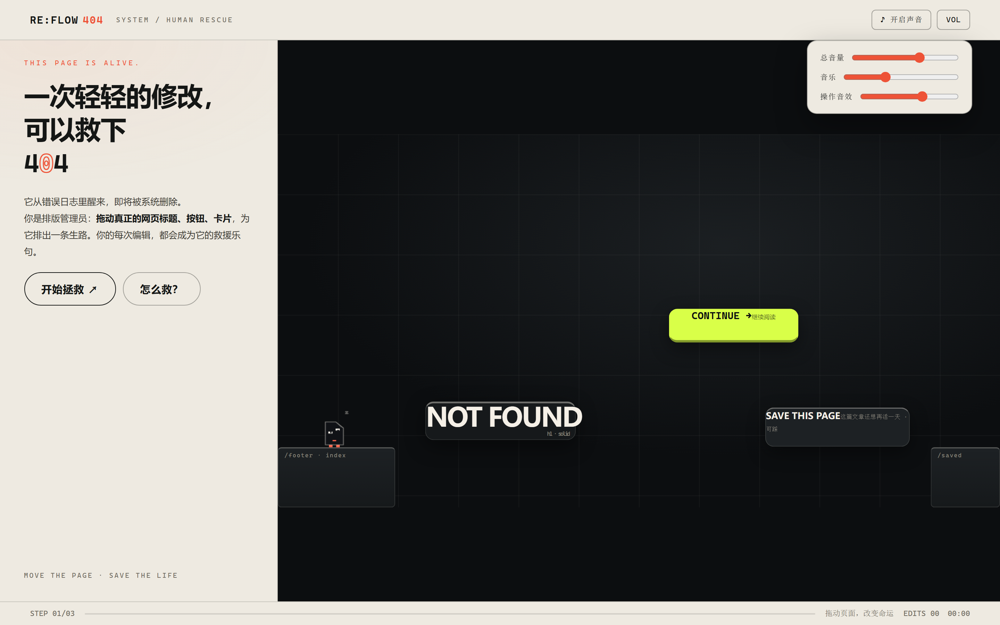 | **首屏（桌面）**：暖纸色杂志外壳 + 左侧品牌海报栏（巨型标题、印刷错位 ±2px 的 404、`开始拯救` CTA）+ 右侧深墨舞台（3 个真实网页模块 + 2 块地面已在后台就位）。0 帧等待即可开始 |
| 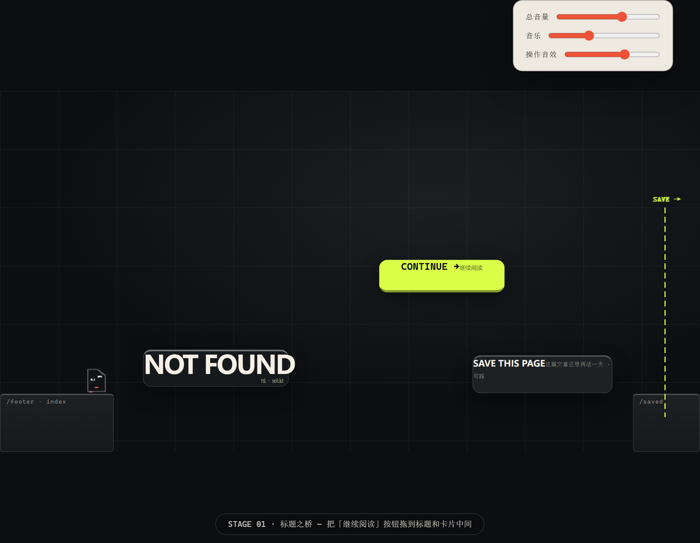 | **第一幕开局**：零四（画布上的折页角小生物）站在左侧 `/footer` 地面上自动向右跑；前方是断崖——`NOT FOUND` 标题悬在半空，`CONTINUE →` 按钮停在一个够不到的错误高度，远处是 `SAVE THIS PAGE` 卡片和出口虚线 |
| 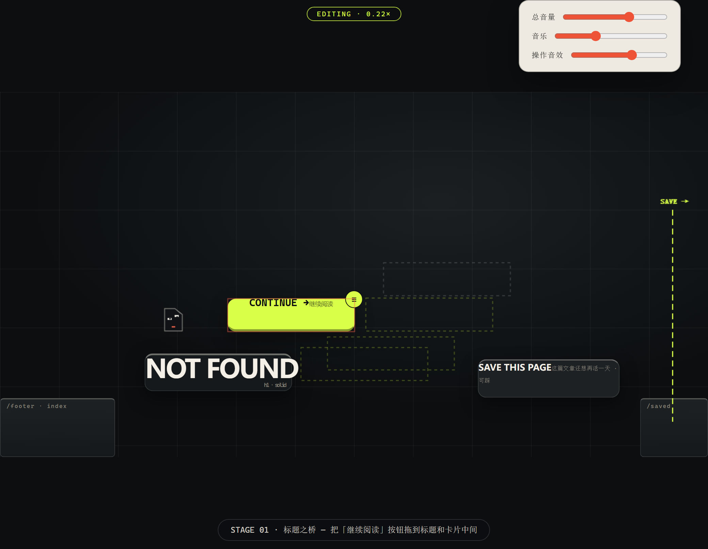 | **拖拽中（0.22× 慢放）**：按住 ≡ 手柄拖动按钮——所有合法锚点显示为虚线框、最近可吸附锚点高亮为酸柠色粗虚线、当前投影为橙红描边；顶栏出现 `EDITING · 0.22×` 胶囊；小精灵减速但仍在跑 |
| 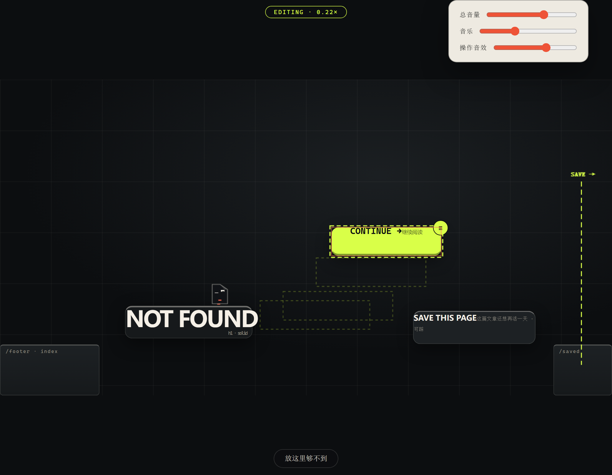 | **小精灵跳上标题**：自动跳跃规划器解出抛物线可行，零四已站在 `NOT FOUND` 大字的顶面上——真实 `<h1>` 的矩形就是它的地面 |
| 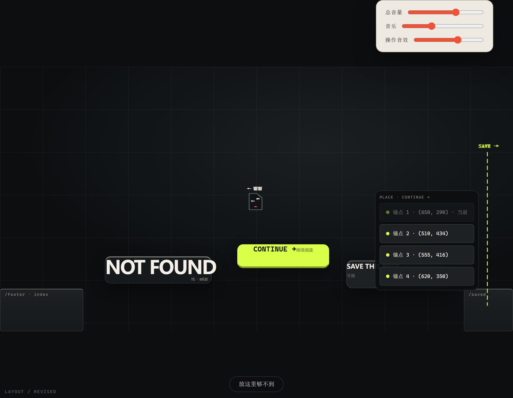 | **按钮已吸附到锚点 (555,416)**：一次编辑完成，路线成形——标题 → 按钮（弹板）→ 远处卡片 → 出口。EDITS 计 1 |

### 2.2 第二幕「弹跳阅读」

| 截图 | 画面说明 |
| --- | --- |
| 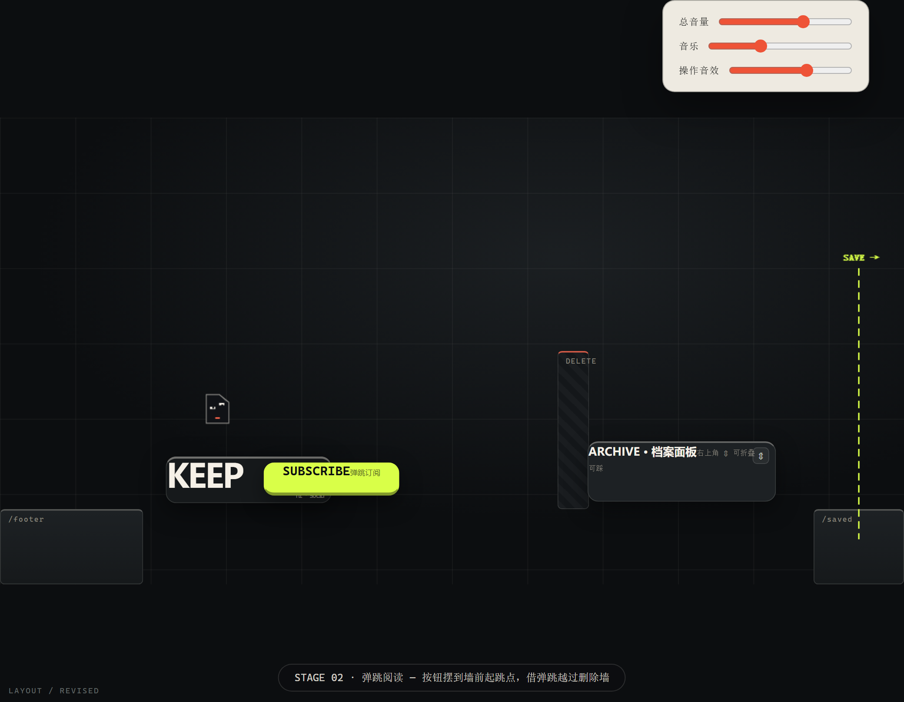 | **第二幕开局**：中央立着条纹 `DELETE` 删除墙（普通跳跃最高 140 单位，跳不过 230 单位的墙）；弹跳按钮初始停在错误位置；右侧是可折叠的 `ARCHIVE` 档案面板 |
| 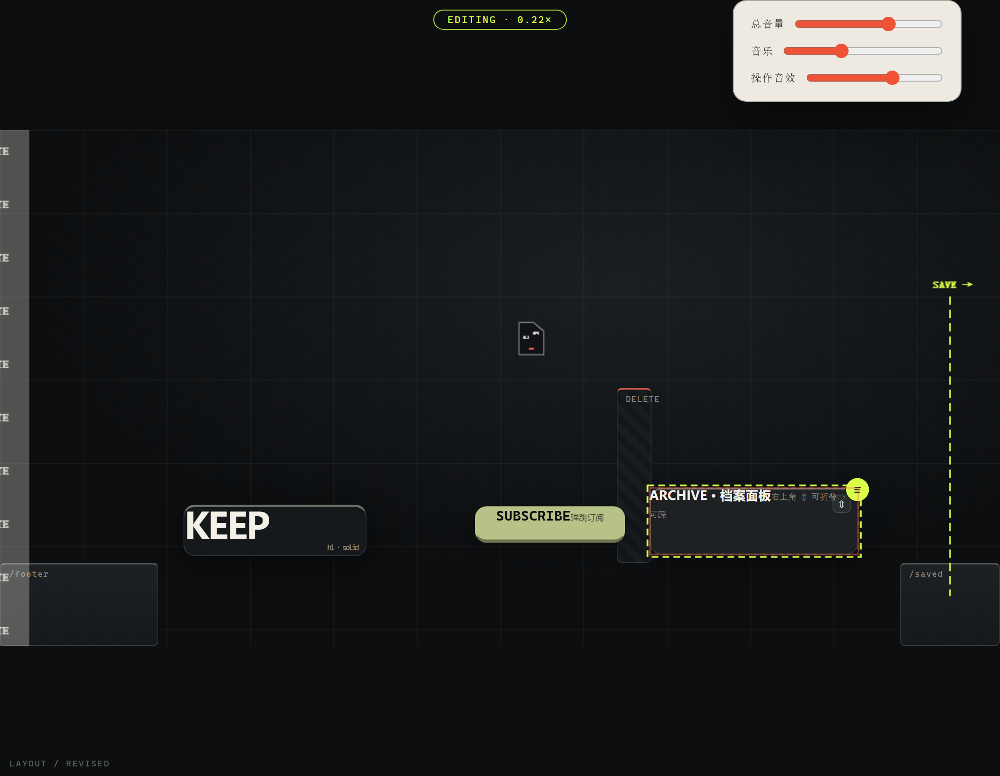 | **弹跳越墙瞬间**：按钮已拖到墙前起跳锚点，零四踩上按钮被弹起（冲量 -890）——截图定格在半空 (646,260)，正越过 DELETE 墙顶 |

### 2.3 第三幕「响应式风暴」与结局

| 截图 | 画面说明 |
| --- | --- |
| 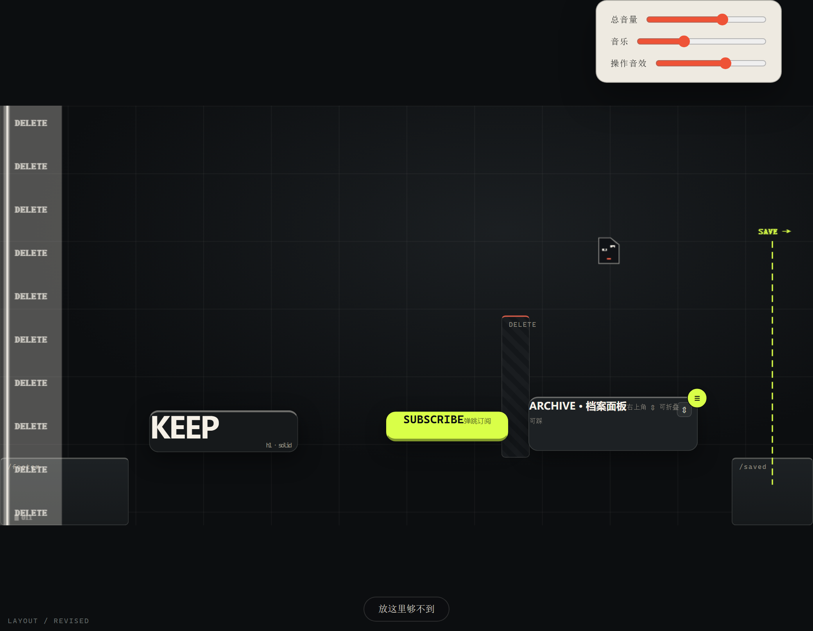 | **第三幕 · gallery 杂志目录布局**：5 块网页模块散落排布——数学上不存在任何连续路径（单测证明）。右上角 `LAYOUT·GALLERY` 开关等待切换 |
| 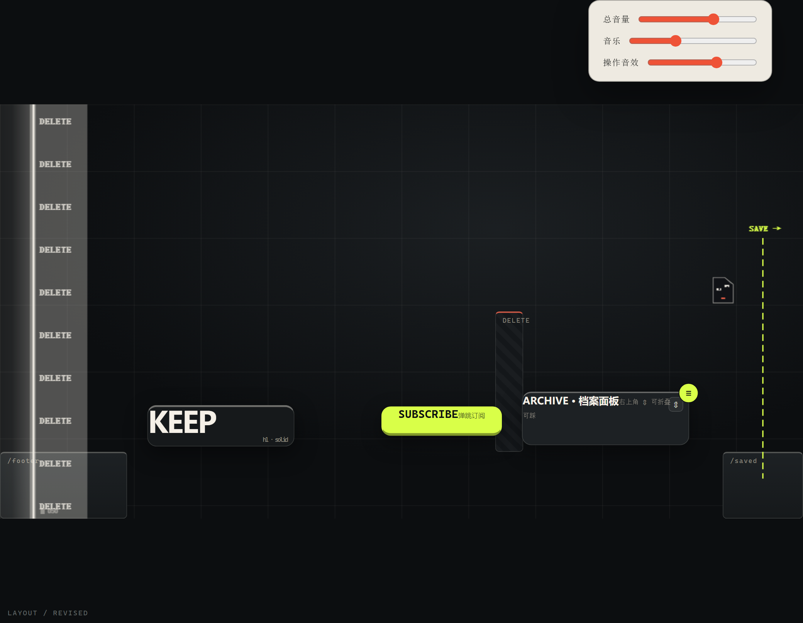 | **切换 LAYOUT·BRIDGE 后**：5 块模块重排成 40 间距 / 30 落差的连续阶梯——路"被排版"出来了。模块移动期间小精灵被平台携带，不会掉落 |
| 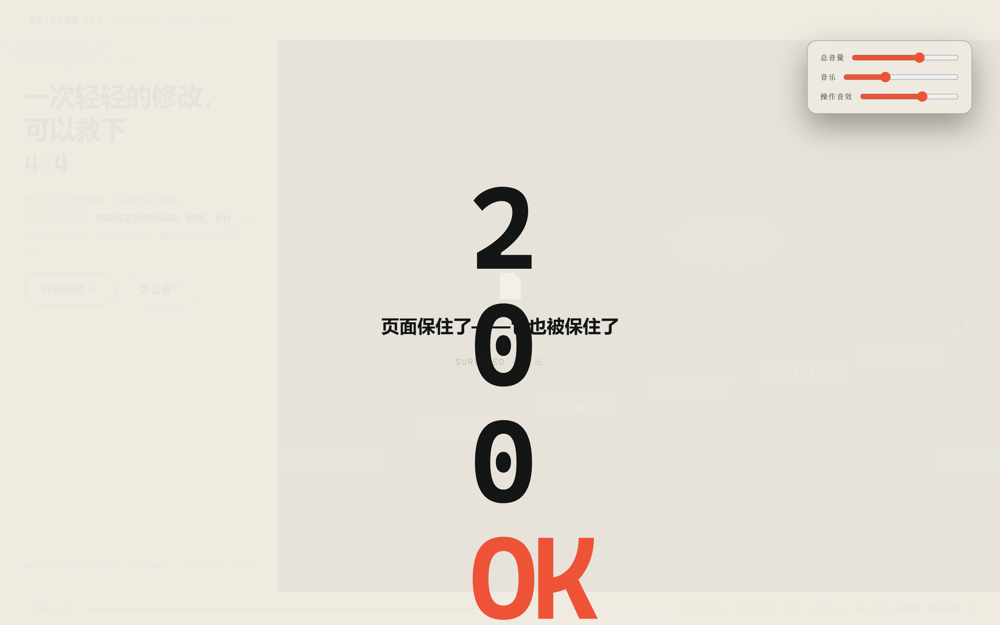 | **通关结算（演出终帧）**：`404 → 200 OK` 真实 DOM 重排、零四跳进新 LOGO 下方；三行战绩（SURVIVED / EDITS·TIME / 你排的乐句）+ 四个 CTA（再改写一次 / 挑战更少编辑 / ♪ 再听一次我的页面 / 分享战绩） |
| 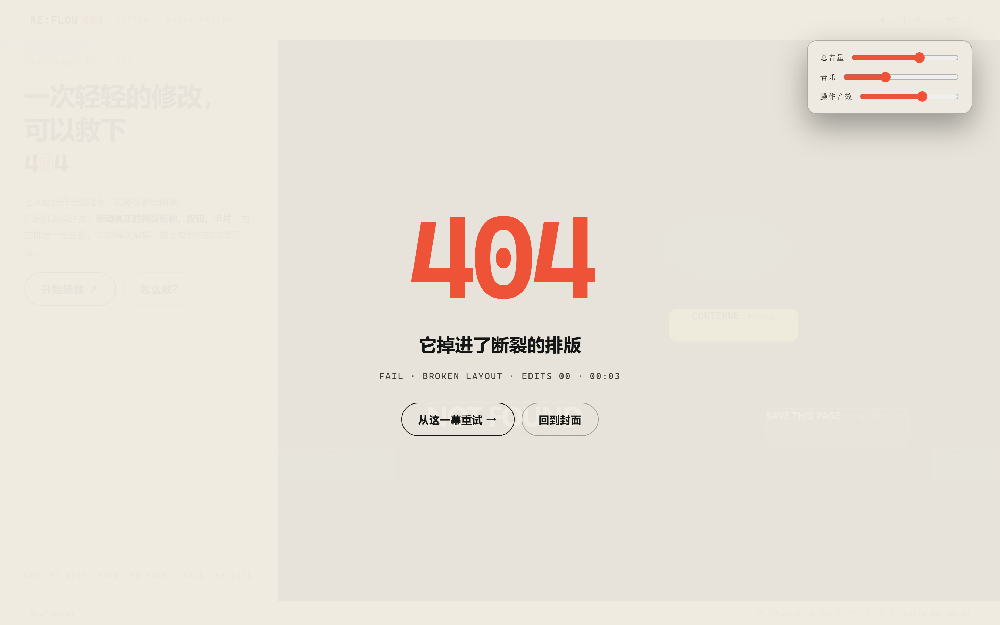 | **失败结算**：朱砂色 `404` + 明确死因（清理波追上了它 / 它掉进了断裂的排版）+ 当幕数据；`从这一幕重试 →` 一键重开，前面通过的幕不丢 |

### 2.4 备选输入

| 截图 | 画面说明 |
| --- | --- |
| 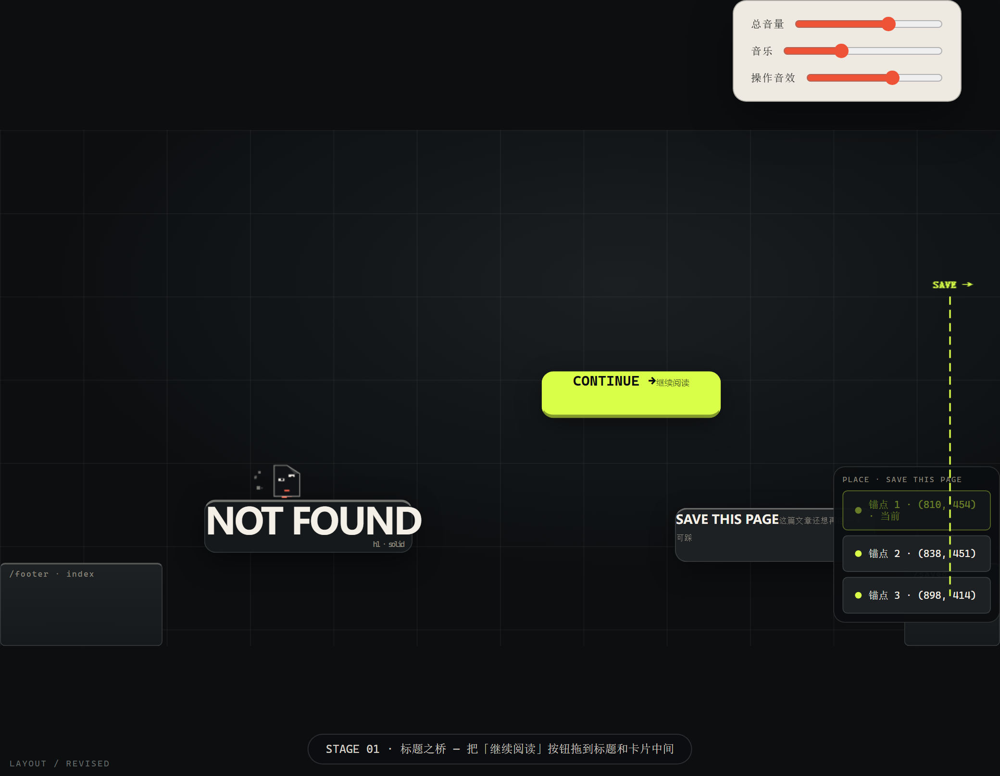 | **锚点选择浮层（点选输入）**：点一下模块本体，浮出 `PLACE` 面板，列出全部合法锚点（当前位灰显）——手机主输入 / PC 备选，44px 命中，与拖拽走完全相同的引擎路径 |

### 2.5 手机端（390×844 竖屏）

| 截图 | 画面说明 |
| --- | --- |
| 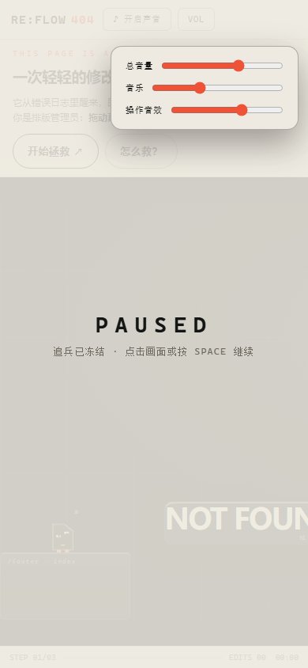 | **手机首屏**：海报栏折叠为顶部条（标题 + 副标 + 双 CTA 44–48px），首屏即可开始，无需下滚 |
| 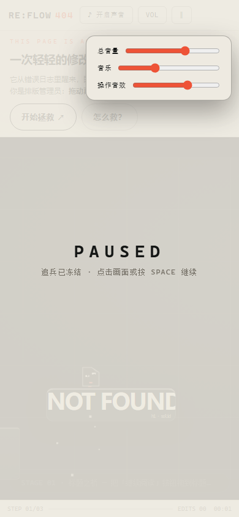 | **手机游戏中**：镜头横向跟随零四（世界 1200 宽，可视窗口约 460 单位），页面本体无横向滚动 |
|  | **手机锚点浮层**：点模块 → 选锚点的主输入路径，按钮 ≥44px 触控命中 |

---

## 三、怎么玩：完整操作手册

### 3.1 三种等价输入（同一引擎路径，计分/声部/事件完全一致）

| 平台 | 主输入 | 步骤 | 备选 | 键盘（辅助） |
| --- | --- | --- | --- | --- |
| **PC** | 手柄拖拽 | ① 鼠标移到模块上（≡ 手柄显形）② 按住手柄拖动（世界 0.22× 慢放）③ 松手吸附到最近虚线锚点 | **点一下模块本体** → 浮出锚点列表 → 点选落位 | `Tab` 聚焦手柄 → `Enter` 触发锚点浮层 → 点选 |
| **手机** | 点选锚点 | ① 点模块 → 锚点浮层弹出（6 秒无操作自动关闭）② 点目标锚点 → 模块飞过去吸附 | 长按 ≡ 手柄拖动（44px 手柄） | — |
| **全局** | — | — | — | `SPACE` 暂停 · `R` 重试当前幕 · `M` 静音 · `Esc` 取消/关面板 · 结算页 `Enter` = 主按钮 |

### 3.2 核心规则（7 条）

1. **你不控制零四**。它永远向右跑（195 单位/秒），到站台边缘自动评估跳跃。你全部的影响力 = 把什么模块放到哪个锚点。
2. **拖动时世界 0.22× 慢放**——是整个世界（含清理波）一起慢，公平；但不会暂停，你仍有时间压力。
3. **吸附锚点制**：松手时模块吸附到 30 单位内最近的锚点。放到无效位置 → 单次 2px 轻摇 +「放这里够不到」→ 弹回原位，**不扣任何东西**。试错完全免费。
4. **计分只认有效编辑**：吸附到与之前不同的锚点才计 1 次 `EDITS`（拖回原位 / 取消不计）。
5. **清理波**从左侧推进，速度逐幕加快（36→42→50 单位/秒），开局有 2–2.5 秒延迟。它经过的网页内容会被真实擦除（模块淡出、失去碰撞）。
6. **两种死法**：被清理波追上（间距 ≤18）或坠入排版断层（虚空）。结算页会写明具体原因。
7. **最短通关 = 3 次编辑**（每幕各 1 次，有单元测试背书）。结算页的「挑战更少编辑」只在可证明时给出确切目标。

### 3.3 四类模块 = 四种"物理语法"

| 模块 | DOM 语义 | 游戏语义 | 视觉特征 | 注意事项 |
| --- | --- | --- | --- | --- |
| **标题** `NOT FOUND` / `KEEP` | `<h1>` 真实标题 | **稳固桥面**：宽大可靠的可站立平台 | 纸白大字 + 墨底卡片 + 顶部亮线 | 太宽，占据大量排版空间 |
| **按钮** `CONTINUE →` / `SUBSCRIBE` | `<button>` 真的可点击 | **弹跳板**：踩上即弹起（冲量 -890，比普通跳高 66%、远 30%） | 酸柠绿实心 + 底部厚边 | 0.5s 冷却（冷却内 = 普通平台）；点击本体 = 英雄站上去时手动触发弹跳 |
| **面板** `ARCHIVE` | `<article>` + 折叠钮 | **可折叠平台**：点右上 ⇕ 在 80↔42 高度间真实切换 | 墨灰卡片 + 折叠区 | 折叠改变落点高度——可能堵路也可能开路 |
| **布局开关** `LAYOUT` | `<button aria-pressed>` | **整体地形重排**：第三幕 5 块模块 gallery↔bridge 两种排版 | HUD 右侧开关 | 切换有 0.26s 重排动画；站在被移动的模块上会被携带 |

### 3.4 HUD 读法

- **顶栏（纸色）**：`RE:FLOW404` 品牌 · `♪ 开启声音`（默认静音，点击 opt-in）· `VOL`（总/音乐/音效三滑块弹层）· `‖` 暂停
- **底栏（纸色）**：`STEP 01/03` 进度 · 朱砂进度线 · 当前目标一句话 · `EDITS 00` + `TIME 00:00` · 第三幕多一个 `LAYOUT` 开关
- **舞台内**：底部提示胶囊（教学/警告，自动淡出）· 左下 `LAYOUT / REVISED` 排版标尺（每次编辑闪一下）· 拖拽时顶部 `EDITING · 0.22×` 胶囊

### 3.5 第一次玩（30 秒上手路径）

1. 点 `开始拯救 ↗` → 小精灵开跑
2. 看到底部提示`点一下网页模块（或拖 ≡ 手柄）`时，**点那个绿色 CONTINUE 按钮**
3. 在浮层里选中间的锚点 → 按钮飞到断崖中间 → 小精灵跳上去、弹起来、一路到出口
4. `404 → 200 OK`，看到你的战绩和乐句 → 点 `再改写一次` 试试 3 次编辑通关

---

## 四、三幕关卡逐幕详解

> 世界坐标 1200×620（逻辑单位，非 CSS 像素）。每一幕的"不编辑必败 / 参考解必胜 / 多路线存在"都有单元测试证明（见 §8.2）。

### 4.1 第一幕 · 标题之桥（STEP 01/03，清理波 36/s，延迟 2.5s）

- **地形**：左地面 `[0,520,195,100]` － 断崖 － 右地面 `[1085,520,115,100]`，出口 x≥1140
- **初始局面**：`NOT FOUND` 标题 (245,444,250×64) 悬在崖间中段（够得着，能当第一块踏板）；`CONTINUE →` 按钮停在 (650,290)——一个**够不到的错误高度**；`SAVE THIS PAGE` 卡片 (810,454) 在右半区
- **参考解（1 次编辑）**：把按钮拖到锚点 **(555,416)**——标题右缘 → 按钮（踩上弹起）→ 越过整段断层 → 落在卡片上 → 右地面 → 出口
- **高阶路线**：锚点 (620,350) 看起来"更高更近"，但直接弹跳差一点够不到卡片——会触发**二段弹跳**（利用按钮 0.5s 冷却后的第二次弹）走一条风险更大的路线，同样可通关（单测验证 ≥2 次 bounce）
- **这一幕学到**：网页模块真的能踩、能搬——编辑是必需的，不是装饰

### 4.2 第二幕 · 弹跳阅读（STEP 02/03，清理波 42/s，延迟 2s）

- **地形**：左地面 → `KEEP` 标题 (220,450) → **DELETE 删除墙** `[740,310,42,210]`（普通跳跃最高 140 单位，墙高 230——必须借弹跳）→ `ARCHIVE` 档案面板 (780,430,250×80，可折叠到 42) → 右地面
- **初始局面**：`SUBSCRIBE` 弹跳按钮停在 (350,458)——**从这个位置起跳越不过墙**（单测证明）
- **参考解（1 次编辑）**：把按钮拖到 (570,452)——英雄从标题跳上按钮 → 弹起越过墙顶（余量 59 单位）→ 落在档案面板 → 右地面
- **稳妥路线（2 次编辑）**：标题右移到 (270,450) + 按钮到 (570,452)——弹跳窗口更宽
- **这一幕学到**："什么时候松手"本身成为决策——编辑期间世界只是变慢，没有停

### 4.3 第三幕 · 响应式风暴（STEP 03/03，清理波 50/s，延迟 2s）

- **地形**：左地面 → 5 块 `A-01…E-05` 网格模块（真实 `<article>`，各 150×46）→ 右地面
- **gallery 杂志目录**：5 块散落（230,470 / 560,340 / 700,280 / 430,270 / 830,300）——**从第一块之后任何方向都够不着**（单测证明无连续路径）
- **bridge 阶梯**：5 块排成 40 间距 / 30 落差的连续上行阶梯 → 逐块可跳 → 末端接右地面
- **玩法**：点 `LAYOUT` 开关 → 0.26s 引擎驱动重排动画（模块飞行、英雄被携带）→ 路出现。**时机敏感**：开局切 / 上到第一块后再切都赢；等英雄坠落开始后切大概率败（单测验证）
- **这一幕的表达**：`整个响应式布局真的被我改了`——不是预制动画，是真实 DOM 布局模式变化驱动游戏地形

### 4.4 通关演出时间线（可跳过）

```
t=0.0s  零四抵达出口，输入冻结
t=0.4s  [跳过演出 ⏭] 出现（点击/Enter 直接到终帧）
t=0.6s  "404" 三个数字活字分离（位移+旋转+降透明度）
t=1.1s  DOM 重排为 "200 OK"（真 DOM 文字，可选中复制，不是贴图）
t=1.6s  零四跳进新 LOGO 下方 + 你的专属救援乐句响起（3–5s，由本局激活的声部合成）
t=2.6s  战绩逐行浮现：SURVIVED → EDITS xx 次编辑 · 时间 → 你排的乐句：声部名 · A-C-E-B
t=3.2s  CTA 组：[再改写一次] [挑战更少编辑（3 次可解·你用了 N 次）] [♪ 再听一次我的页面] [分享战绩] [回到封面]
```

**失败演出**（无演出、直达）：朱砂 `404` + 死因 + 当幕数据 + `从这一幕重试 →`。700ms 内可点。

---

## 五、声画系统：排版即编曲

> v4 的核心表达：**DOM 是地形，也是乐器。改布局就是改配器。** 它不是节奏游戏——不跟拍、不用节奏判定生死——音乐只是忠实地随你的有效编辑而演化。

### 5.1 音乐如何随你的操作生长

| 触发 | 音乐里发生什么 | 实现位置 |
| --- | --- | --- |
| 点 `开始拯救` | 氛围垫（A2 锯齿+低通）+ 每拍脉冲低音启动 | `onRunStart()` |
| 摆好一个**标题**（h1） | 下一**小节**边界加入低音拨弦声部（A2/C3 交替） | `onValidEdit('HEADING')` |
| 摆好一个**按钮**（button） | 下一小节加入钟琴动机——A-C-E-B 四音品牌动机逐小节推进一个音 | `onValidEdit('BUTTON')` |
| **折叠**一个面板（article） | 下一小节加入纸页打击（2/4 拍轻噪） | `onValidEdit('PANEL')` |
| 切换**布局**（grid） | 和声开阔化——氛围垫叠加 E3/C4，色彩转向 C 大调 | `onValidEdit('GRID')` |
| 清理波逼近（<240 单位，持续 0.3s 滞回） | 危机金属 tick 进入（每小节第 3 拍后半） | `setDanger()` |
| 失败 | 传输层停止、全部循环静默，只剩 350ms 低沉纸片落地 | `onFail()` |
| 通关 | 本局激活的声部合成 3–5s 救援短句：A-C-E-B 完整陈述 + C 大调解决 | `playRescuePhrase()` |
| 结算页 `♪ 再听一次我的页面` | 单独回放本局乐句 | `replayMotif()` |

**声部状态机保证两点**：① 声部变更先进 `pending` 队列，只在下一小节边界（`beatIndex % 4 === 0`）应用——一次编辑绝不会把同一声部触发两遍；② 无效拖拽不解锁任何声部（QA 验证项）。

### 5.2 事件音效表（全部带冷却守卫）

| 事件 ID | 触发 | 声音 | 冷却 |
| --- | --- | --- | --- |
| `ui.hover.actionable` | 指针进入手柄 | 30ms 短木音 | 同元素 300ms |
| `edit.grab` | 合法 pointerdown | 纸片离面声 | 每次拖拽 1 次 |
| `edit.preview.valid` | 进入新锚点吸附圈 | 轻高音 | 150ms |
| `edit.preview.invalid` | 离开吸附圈/无效停留 | 温和下行音 | 600ms |
| `edit.snap.valid` | 真实变更的吸附 | 「咔+叮」双音 | 真实变更才发 |
| `character.jump` | 物理起跳 | 纸角张开声 | 每跳 1 次 |
| `character.land` | 物理落地 | 温柔落木声 | 80ms 去重 |
| `character.bounce` | 踩上弹跳按钮 | 高音 boop（C5→A5 滑音） | — |
| `character.near_miss` | 首次逼近清理波 | 有方向提示音 | 1200ms |
| `module.erase` | 模块被清理波吞掉 | 纸张消散 | 250ms |
| `grid.switch` | LAYOUT 切换 | 纸刷+上行双音 | — |
| `game.retry` | 重试 | 翻页上扬 | — |
| `character.win` / `character.fail` | 胜/负 | 救援乐句 / 低沉下坠 | 状态只 1 次 |

### 5.3 音频工程规格

- **合成**：100% Web Audio（OscillatorNode / NoiseBuffer / BiquadFilter / DynamicsCompressor），**零音频文件**，离线可玩
- **传输层**：112 BPM（beat=0.5357s），50ms `setInterval` 轮询 + 140ms lookahead，用 `audioCtx.currentTime` ahead-scheduling 精确调度
- **总线**：master(0.65) / bgm(0.35) / sfx(0.65) 独立增益 + -12dB 限幅器；`VOL` 弹层三滑杆实时调
- **策略合规**：默认**静音**，`♪ 开启声音` 在用户手势内 resume；`visibilitychange` 即停且回来不自动响；**静音 100% 可玩**，声音永不影响胜负与计分

### 5.4 视觉语言：暖纸杂志外壳 + 深墨交互舞台

| 层 | 色值 | 占比 | 语义 |
| --- | --- | --- | --- |
| 外壳纸底 | `#EEEAE1` | ~45% | 编辑海报气质，首屏高对比 |
| 品牌朱砂 | `#EE5337` | 极少 | **只做品牌**（404 字、进度线），不做状态色 |
| 舞台墨底 | `#0C0E10` / `#16191B` | ~40% | 深黑物理世界，让 DOM 变形可见 |
| 舞台纸白 | `#F5F0E7` | 平台主文字 | 印刷纸感、真实可踩 |
| 可操作酸柠 | `#D9FF48` | 5–7% | **可拖 / 合法锚点 / 可拯救机会** |
| 危险橙红 | `#FF6B52` | 极少 | 清除线 / 危险 / 失败 |
| 静音灰绿 | `#777F7D` | 小面积 | HUD 非交互辅助 |

**不靠颜色单独表意**：吸附/错误/危险永远同时有形状（虚线框 / × / 描边）+ 文案 + 边界变化（色弱可玩）。

**动效时序表**（克制原则）：

| 动作 | 时长/曲线 | 说明 |
| --- | --- | --- |
| 手柄显形 | 120ms | hover 由虚到实 |
| 拖拽抬升 | 110ms ease-paper | `.mod-lift` 包裹层 -4px + scale1.015（纯视觉层，不碰碰撞盒） |
| 吸附回弹 | 130ms | overshoot 缩放 + 酸柠描边闪光 |
| 无效轻摇 | 260ms | 单次 ±2px，`prefers-reduced-motion` 下关闭 |
| 网格重排 | 260ms ease-expo | 引擎插值驱动（见 §7.6） |
| 结算演出 | 3.2s | 可 0.4s 跳过 |

---

## 六、底层架构设计

### 6.1 分层总览

```
┌──────────────────────────────────────────────────────────────────┐
│ index.html    暖纸外壳：header / 品牌海报栏 / 舞台容器 / 结算演出层    │
├──────────────────────────────────────────────────────────────────┤
│ main.ts       主循环（固定步进累加器）/ 场景流 / 输入 / 演出编排       │
├────────────┬───────────────────────────┬─────────────────────────┤
│  bridge/   │         game/            │      ui/ + effects/     │
│  DOM 世界桥 │      纯逻辑引擎（权威）      │     声音 + 角色渲染       │
│            │                          │                         │
│ DOMWorld-  │ engine.ts                │ AudioDirector.ts        │
│  Bridge    │  · 物理积分(60Hz)          │  · 112BPM 传输层          │
│  模块注入/  │  · 单向平台碰撞             │  · 声部状态机+小节边界      │
│  每帧测量/  │  · 抛物线跳跃规划器          │  · 事件音效冷却表          │
│  拖拽/锚点  │  · 清理波推进/擦除          │  · 乐句录制与回放          │
│            │  · 拖拽锚点/携带物理         │ CharacterRenderer.ts    │
│ Coordinate-│  · 面板折叠                │  · 零四（折页角小生物）      │
│  Mapper    │  · 网格重排插值动画          │  · 清理波扫描边           │
│  client↔   │ levels.ts                 │  · 粒子/锚点幽灵          │
│  world 换算 │  · 物理常量 / 三幕数据       │    （Canvas 2D 透明层）    │
├────────────┴───────────────────────────┴─────────────────────────┤
│        真实 DOM（h1/button/article/footer）＝ 物理平台              │
│        Canvas#fx（pointer-events:none, z-index:40）＝ 只画动态物    │
└──────────────────────────────────────────────────────────────────┘
```

### 6.2 三条架构铁律（"真 DOM 即物理"不是话术的保证）

1. **引擎不 import DOM**——`src/game/` 是纯 TypeScript，只认 `Rect[]` 数据。它可以在 Node 里完整跑完一局（30 项单测就是这样验证可解性的，不需要浏览器）
2. **碰撞权威 = DOMRect 测量**——每帧 `measurePass()` 把所有平台的 `getBoundingClientRect()` 经 `CoordinateMapper` 折算成世界坐标喂给引擎；引擎的落地判定永远对应你眼睛看到的真实元素位置
3. **表现只消费事件**——引擎 `drainEvents()` 输出语义事件（HERO_LAND / DRAG_SNAP / LEVEL_FAIL…），音频/粒子/屏幕流各自订阅，谁也不能回写物理状态。动画再花哨改不了胜负

### 6.3 一次拖拽的完整数据流

```
pointerdown（≡ 手柄）
 ├→ DOMWorldBridge.attachDrag
 │   └→ engine.beginDrag(moduleId)     校验 phase=RUNNING/未锁/在场名额
 │        └→ phase=DRAGGING（全局 timeScale=0.22）
 ├→ handle.setPointerCapture(pointerId)（pointercancel/lostpointercapture 安全回收）
pointermove
 ├→ CoordinateMapper.deltaToWorld()    client px→world 单位（实测比例，不猜）
 ├→ engine.previewDrag(dx,dy)          引擎权威矩形更新（含边界钳制）
 ├→ renderPass() 把预览位置写回元素 transform（视觉跟随）
 ├→ 锚点吸附圈检测 → 进入/离开各触发一次 preview 音（150ms 冷却）
 └→ 期间 measurePass 对其它模块照常测量；被拖模块的碰撞=引擎预览值
pointerup
 ├→ engine.finishDrag()
 │    ├─ 最近锚点≤30单位 → 吸附/anchorIndex更新/edits+1 → 事件 DRAG_SNAP
 │    └─ 否则 → 回弹原锚点，不计编辑                → 事件 DRAG_CANCEL
 ├→ DRAG_SNAP → AudioDirector.onValidEdit(action)
 │    └─ 对应声部 pending → 下一小节边界生效（绝不重复叠加）
 ├→ 视觉：syncAfterEdit() 写 left/top + snap-flash 回弹动画
 └→ 首次救援 → 零四回头「← 谢谢」（每局限 1 次）
```

### 6.4 主循环（固定步进）

```ts
accumulator += 真实帧差(上限100ms);
while (accumulator >= 1/60 && steps < 8) {
  engine.tick(1/60 × engine.timeScale());   // 慢放对角色和清理波一视同仁
  accumulator -= 1/60;
}
bridge.measurePass()  // 每帧一次统一 DOM 读（防强制重排抖动）
bridge.renderPass()   // 统一 DOM 写
renderer.render()     // Canvas：角色/清理波/粒子
```

---

## 七、核心实现细节

### 7.1 物理常量表（`src/game/levels.ts`，全部可调）

| 常量 | 值 | 含义 |
| --- | --- | --- |
| `gravity` | 1700 单位/s² | 重力 |
| `heroRunSpeed` | 195 单位/s | 零四奔跑速度 |
| `heroJumpImpulse` | -690 | 普通跳跃冲量（最高 140 单位 / 最远 158） |
| `bounceImpulse` | -890 | 弹跳板冲量（最高 233 / 最远 204） |
| `coyoteTime` | 0.09s | 土狼时间（离台后仍可起跳窗口） |
| `edgeLookahead` | 14 单位 | 距站台右缘多远开始评估跳跃 |
| `hesitateTime` | 0.45s | 无路可跳时的边缘犹豫（显示 `!`）再继续跑 |
| `dragTimeScale` | 0.22 | 拖拽全局慢放倍率 |
| `snapThreshold` | 30 单位 | 锚点吸附判定半径 |
| `maxJumpGap` | 175 单位 | 规划器考虑的最大跳距 |
| `catchDistance` | 18 单位 | 清理波追击判定距离 |
| `cleanerSpeed` | 36 / 42 / 50 | 三幕清理波速度 |

### 7.2 单向平台碰撞（为什么标题拖到脚下不会挤死它）

```
落地条件（同时满足）：
  ① 上一帧脚底 ≤ 平台顶+1 && 本帧脚底 ≥ 平台顶   （只拦截下落穿越顶面）
  ② 水平重叠 ≥ 8 单位                            （擦边不算）
从平台下方向上穿越：不碰撞（无天花板）
——所以把标题拖到小精灵身下，它只会"从下面钻过去再落上来"，不会被夹死。
```

站立检测每 tick 复验：平台还在脚下吗（重叠 ≥4 且高差 ≤2）？不满足 → 进入土狼时间 → 可能坠落。平台被清理波擦除时同样触发。

### 7.3 抛物线自动跳跃规划器（跳与不跳由物理决定）

每 tick，若零四距当前站台右缘 ≤14 单位：

1. 收集前方所有候选平台（右缘在本台右缘之后、顶面不高于脚下 200 单位）
2. 对每个候选解二次方程求**下降段**交点：`t = (-vy + √(vy² + 2g·(targetTop-feetY))) / g`，`落点x = heroX + vx·t`
3. 落点必须落在目标平台 x 范围 ±（半身-8）内、水平间距 ≤175、飞行 ≤1.4s
4. 有解 → 选**最早可到达**者起跳（planner 不能传送角色，实际轨迹仍由积分决定）
5. 无解 → 边缘犹豫 0.45s（头顶橙 `!`）→ 继续跑（可能坠崖）——失败永远可归因

单测断言了对称抛物线距离 158.3（数学正确性）与过高/过远不可达。

### 7.4 平台携带物理

小精灵站着的平台被拖动/重排时：`hero += clamp(平台位移, ±120/步)`——每步限幅防穿墙；水平+垂直都携带。这就是"拖着桥走，小精灵跟着桥走"的实现。

### 7.5 坐标映射（`CoordinateMapper`）

- 世界面固定 **1200×620 CSS px**，外层 `transform: scale(s)` 适配任意视口（桌面 fit 全景 / 手机 `min(vh/620, vw/460)` + `translateX(-camX)` 镜头跟随）
- 所有 client↔world 换算基于 `world.getBoundingClientRect()` **实测比例**——DPR、浏览器缩放、窗口旋转天然正确，有单测覆盖多视口
- 指针位移换算同源（拖拽的 delta 也是世界单位），绝不把 CSS px 当逻辑单位

### 7.6 网格重排动画为什么放在引擎里（踩坑记录）

最初用 CSS `transition: left/top` 做第三幕重排——本地完美，但**后台标签页的 left/top 过渡会冻结**，`measurePass` 把引擎里的新坐标覆写回旧布局，导致英雄掉落。修复：重排改为**引擎内 0.26s ease-expo 插值动画**（`gridTween`，在 tick 中推进），DOM 同步渲染引擎坐标；动画期间测量让位（引擎为权威），结束后恢复测量权威。前台/后台行为一致。（调参记录详见 `docs/LEVEL_SOLVABILITY.md`）

### 7.7 锚点点选输入 = 与拖拽同一状态机

点模块 → `openAnchorPop()` 浮层 → 点锚点 → `placeAtAnchor()` 内部走 `engine.beginDrag → previewDrag(锚点delta) → finishDrag` **完整路径**——计 edit、触发声部、产生事件与真实拖拽逐字节一致。这不是"作弊快捷方式"，是同一玩法的低精度门槛入口（手机主输入）。

### 7.8 零四（Zero-Four）角色渲染

Canvas 2D 逐帧程序绘制，五个识别锚点（32×32 仍可辨）：
① 折起的页面角轮廓（方体+右上折角斜切）② 右上 `>` 缺口随跑动张合 ③ 错位双眼（左低右高）**不同步眨眼**（表达"程序不太稳定"）④ 朱砂短腿跑动摆动/空中收腿 ⑤ 落地 squash & stretch 压缩回弹。
性格演出限量供应：每 4–7s 眨眼、首次救援回头「← 谢谢」（每局 1 次）、濒危冒汗滴、犹豫显 `!`、胜利跳进 LOGO。

---

## 八、工程、测试与验证

### 8.1 命令

```bash
npm install
npm run dev       # 开发服务器（Vite）
npm run test      # 30 项 Vitest（node 环境，秒级）
npm run build     # tsc --noEmit 严格检查 + vite build
npm run preview   # 预览生产构建
```

### 8.2 30/30 测试覆盖清单

**物理与交互不变量（`tests/physics.test.ts`，17 项）**：
横向重叠<8 不落地 · 只允许下落穿顶落地 · 下方上穿不撞头 · 土狼时间 90ms 存在 · 抛物线求解数学（158.3 断言）· 过高不可达 · 超距不可达 · 弹跳 0.5s 冷却（冷却内=普通平台）· 拖拽 0.22× 慢放 · 清理波命中只结算一次 · 出口判定优先于清理 · 坠空 FAIL · 合法吸附计 1 edit / 原槽 0 / 取消 0 · pointercancel 回原槽 · 平台携带 · 面板折叠真实变高 · 网格重排插值动画（经历过渡帧、终点正确）· 锚点可达。

**三幕可解性（`tests/levels.test.ts`，13 项）**——用**真实引擎跑完整一局**证明：

| 幕 | 不编辑 | 参考解 | 其他路线 |
| --- | --- | --- | --- |
| 一 | 必败 | 1 edit / 5.8s 胜 | 第二锚点亦胜；(620,350) 二段弹跳高阶路线（≥2 bounce）胜 |
| 二 | 必败 | 1 edit / 5.4s 胜 | 2 edit 稳妥路线胜 |
| 三 | 必败 | 切 bridge / 5.9s 胜 | 1.5s 后切仍胜；3.2s 后切大概率败（时机敏感） |
| 全局 | — | — | 确定性：同输入同轨迹哈希一致 |

### 8.3 浏览器实测清单（Chromium + Playwright / 调试钩子）

- 真实 PointerEvent 拖拽：吸附 / 计分 / 慢放 / 无效回弹 / pointercancel ✓
- 锚点点选输入纯点击通关三幕 → VICTORY → 200 OK 演出 → 挑战/回放/分享按钮 ✓
- 声部解锁与编辑类型一一对应（按钮×2+网格 → bellMotif+openHarmony；未编辑类型不解锁）✓
- 跨幕 edits 累计（EDITS 03 · 00:17）✓（实测发现并修复了只计最后一幕的 bug）
- 手机 390×844：CTA 48px 首屏可见 / 无横向滚动 / 镜头跟随 / 模块可点 / 锚点浮层 ✓
- 失焦自动暂停（世界+音乐一起冻结，回来不自动响）✓
- 15 张状态截图由脚本驱动拍摄（`?debug=1&nvp=1` 钩子：跳幕 / 状态轮询 / 慢放辅助定格精确瞬间）✓
- 重拍截图过程中发现并修复的两个真实缺陷：
  - **暂停遮罩常驻 bug**：`#pause-veil` 的 `display:grid` 声明压过了 UA 样式表的 `[hidden]{display:none}`，导致遮罩在"隐藏"状态下仍然渲染并拦截整个舞台的指针事件——玩家拖不了任何手柄，且所有画面蒙着 88% 暖纱。修复：显式补 `#pause-veil[hidden]{display:none}`。
  - **手柄热区被裁剪 bug**：`.mod-h1` / `.mod-article` 的 `overflow:hidden`（为圆角裁剪而设）把右上角外凸的拖拽手柄一起裁掉，hit-test 同步失效——标题与卡片模块的手柄只剩伸进模块内的小角可点。修复：去掉模块容器 overflow（文字排版实测无溢出，圆角由自身 border-radius 保证），并新增 `nvp=1` 调试参数供无头截图禁用自动暂停。

### 8.4 未验证项（如实声明）

iOS Safari / Android 真机 · 6 人盲测 · 音频人耳品质评审 · 性能 profiling（INP/FPS）。详见 `docs/LEVEL_SOLVABILITY.md` 与 `docs/V4_UPGRADE.md`——不以预期冒充结果。

### 8.5 性能与体积

- **运行时零依赖**（devDependencies 仅构建工具链 + Playwright E2E）
- 生产包 gzip ≈ **15.6KB**（含完整音频合成引擎）
- 布局读写分离（measurePass/renderPass 每帧各一次批量）；拖拽只动 1 个元素的 transform；粒子预算 ≤60；`prefers-reduced-motion` 关轻摇/闪烁

---

## 九、目录结构逐文件说明

```
reflow-404/
├─ index.html                    # 暖纸外壳：header / 品牌海报栏 / 舞台容器 / 音量弹层 / 结算演出层 / 暂停遮罩
├─ package.json                  # 脚本：dev/test/build/preview；无 runtime dependencies
├─ vite.config.ts                # base:'./' 相对路径（任意静态托管子路径可用）
├─ tsconfig.json                 # TypeScript strict 全开
├─ vitest.config.ts              # node 环境单测
├─ src/
│  ├─ main.ts                    # 主循环（固定步进）/ 场景流 / 键盘指针输入 / 结算演出编排 / 测试钩子
│  ├─ styles/main.css            # 全部样式：v4 tokens / 双色调 / 模块视觉 / 拖拽动效 / 锚点浮层 / 响应式 / reduced-motion
│  ├─ game/                      # ★ 纯逻辑引擎（不 import DOM，Node 可独立运行）
│  │  ├─ types.ts                #   GameState / ModuleState / LevelDef / GameEvent 类型
│  │  ├─ levels.ts               #   物理常量表 + 三幕关卡数据（模块/锚点/清理波/网格双布局）
│  │  └─ engine.ts               #   物理积分 / 单向碰撞 / 跳跃规划 / 清理波 / 拖拽锚点 / 携带 / 网格插值 / 事件流
│  ├─ bridge/                    # ★ DOM ↔ World 桥
│  │  ├─ CoordinateMapper.ts     #   client↔world 唯一换算入口（实测比例）
│  │  └─ DOMWorldBridge.ts       #   关卡 DOM 注入 / 每帧测量 / 拖拽 / 锚点浮层 / 擦除同步 / 网格同步
│  ├─ effects/
│  │  └─ CharacterRenderer.ts    #   零四 + 清理波 + 粒子 + 锚点幽灵（Canvas 2D 透明层）
│  ├─ ui/
│  │  └─ AudioDirector.ts        #   112BPM 传输层 / 声部状态机 / 事件冷却 / 总线 / 乐句录制回放
│  └─ utils/
│     └─ storage.ts              #   localStorage 安全封装（隐私模式静默降级）
├─ tests/
│  ├─ physics.test.ts            # 17 项物理与交互不变量
│  └─ levels.test.ts             # 13 项三幕可解性 + 确定性
├─ docs/
│  ├─ CHARACTER_CARD.md          # 主角卡：一句话设定 / 六姿态 SVG / 识别锚点 / AI 制作如实说明
│  ├─ character-card/zero-four.svg
│  ├─ LEVEL_SOLVABILITY.md       # 可解性验证 + 几何调参记录 + 已知限制
│  ├─ ASSET_LICENSES.md          # 零外部素材声明 / 第三方依赖许可
│  └─ V4_UPGRADE.md              # v4 声画升级实施记录（含实测表）
└─ artifacts/                    # 15 张 Playwright 实机截图（桌面 12 + 手机 3）
```

---

## 十、快速开始与部署

```bash
git clone https://github.com/qing1989620/game-1.git
cd game-1
npm install
npm run dev        # → http://localhost:5173
```

**部署**：`npm run build` 产出 `dist/`（`base:'./'` 相对路径）——Vercel / Netlify / Cloudflare Pages / GitHub Pages 任意静态托管，拖上去即玩，无服务端、无 API、无密钥。

**建议的开局体验路径**：打开 → 点 `♪ 开启声音`（听排版即编曲）→ `开始拯救 ↗` → 按底部提示点绿色 CONTINUE 模块 → 选中间锚点 → 看它弹过断层 → … → `200 OK` → `♪ 再听一次我的页面`。

---

## 十一、文档索引与边界声明

| 想了解 | 看 |
| --- | --- |
| 主角设定与识别锚点 | `docs/CHARACTER_CARD.md` + `docs/character-card/zero-four.svg` |
| 关卡数学证明与调参过程 | `docs/LEVEL_SOLVABILITY.md` |
| v4 声画升级怎么实施/测的 | `docs/V4_UPGRADE.md` |
| 素材版权（零外部素材） | `docs/ASSET_LICENSES.md` |

**原创性**：全部视觉（DOM 世界 / 角色 / 粒子）与音频（Web Audio 合成）为代码原创，零外部图片/音频/字体文件；主角设定图为程序化绘制（如实标注，不以 SVG 冒充 AI 生成图）。第三方仅构建工具链（Vite / TypeScript / Vitest / Playwright，均 MIT）。

**诚实边界**：本文所有"已验证"均来自真实浏览器操作与 30/30 单测；未做的测试（真机 / 盲测 / 人耳评审 / 性能 profiling）如实标注，不以预期冒充结果。

> **MOVE THE PAGE · SAVE THE LIFE**
> ——这次主角不是英雄，是那条一直被消耗的 404。
