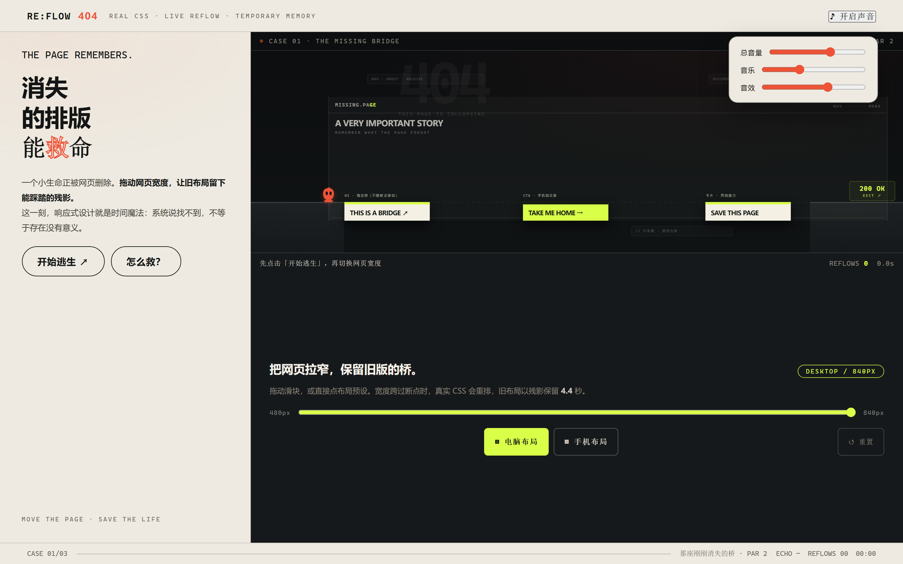
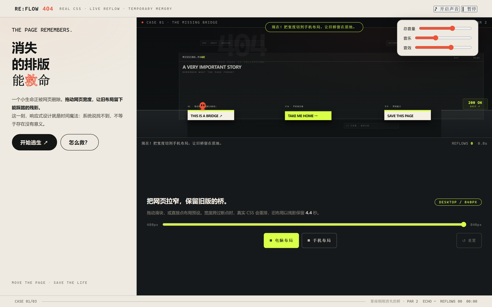
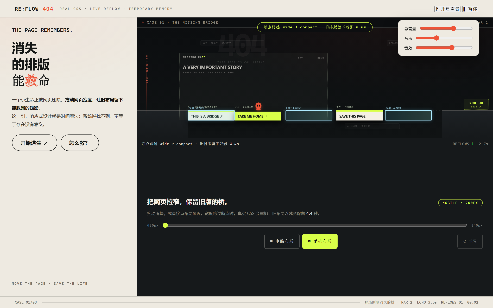
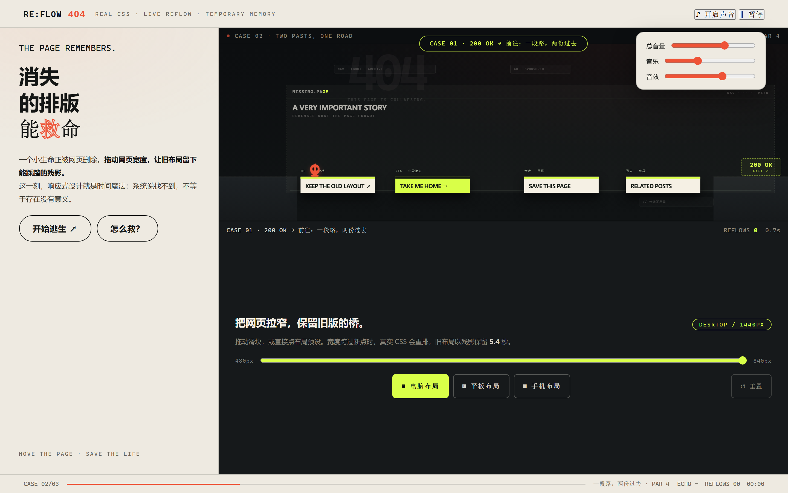
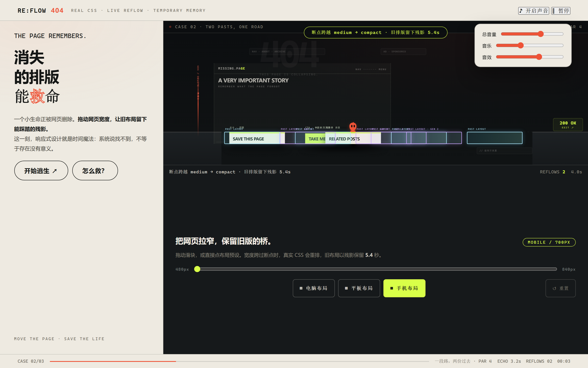
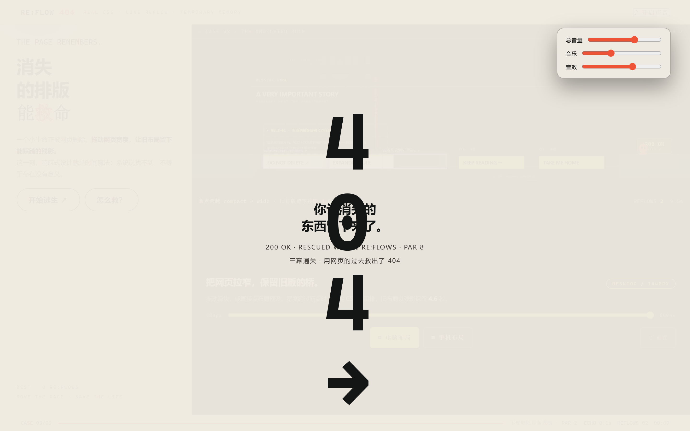
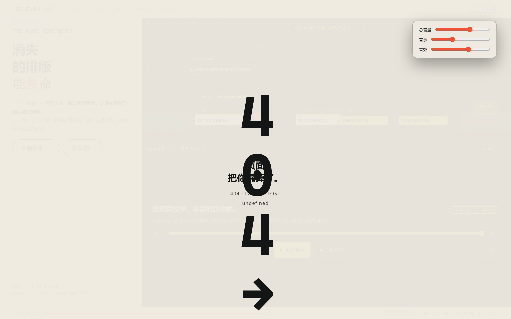
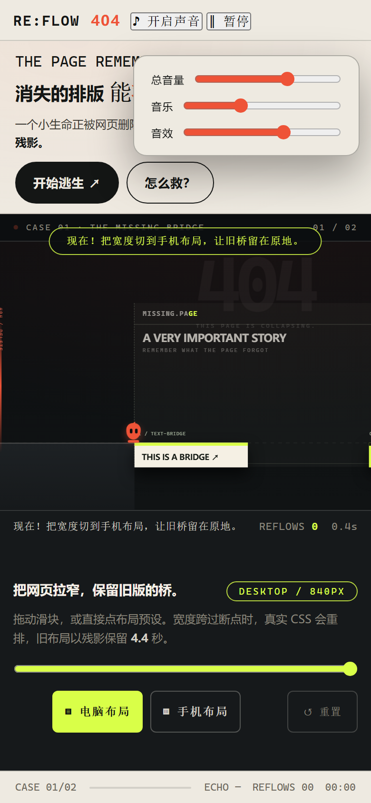
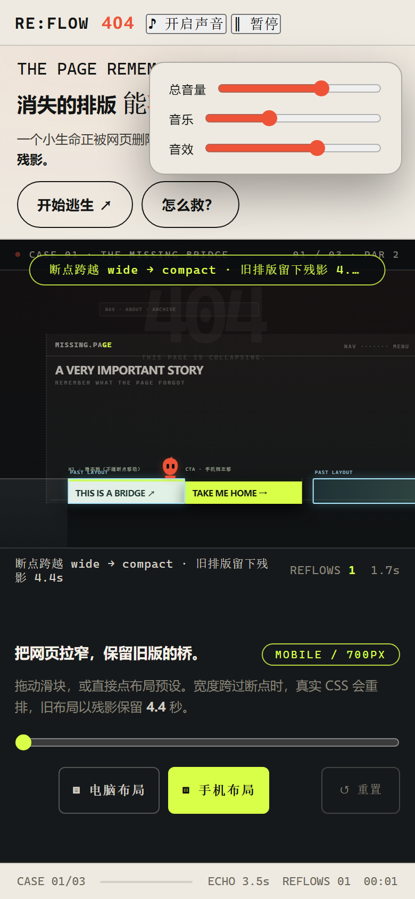
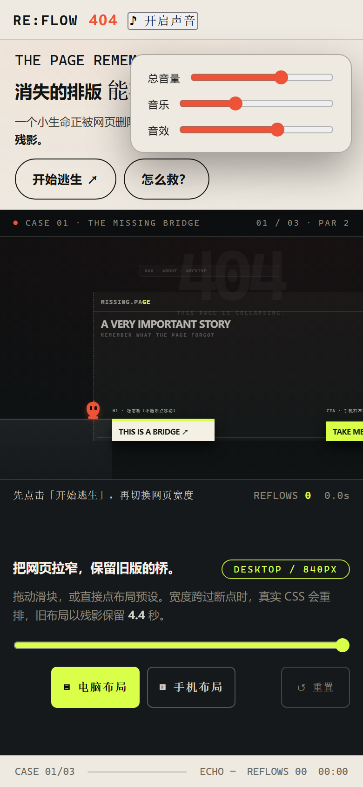

# RE:FLOW 404 · 消失的排版能救命

> **整张网页就是逃生地图。拖动虚拟视口的宽度，真正的响应式 CSS 会实时重排地形；被换掉的旧布局不会立刻消失——它化作只有几秒寿命的蓝色残影，让你用网页的「过去」，救出一个即将被删除的 404 小生命。**
>
> 机制宣言：**宽度 = 世界规则；真实 `@container` 重排 = 地形权威；旧布局快照 = 有寿命的平台；零四（ZERO-FOUR）= 自动前进的你。**

- 玩法一句话：你不是在网页里玩游戏——**网页本身被拖窄的那一刻，桥会移动，旧桥会留下影子，影子可以踩**。
- 三幕递进：L1 双切换教学（PAR 2）→ L2 五段布局四代接力（PAR 4）→ L3 真 `<details>` 折叠规则改变地形（PAR 2）；**清理线在身后推进**，犹豫即删除。
- 与拖积木类玩法的本质区别：模块位置**不是 JS 摆出来的**，是 CSS 容器查询真实回流的结果；物理碰撞直接读 `getBoundingClientRect`。把 DOM/CSS 全删换成图片，游戏即刻不成立。

---

## 一、这个游戏是什么

1. 舞台上有一个「页内虚拟浏览器」（`.sim-browser`，840px 起）。它内部是**一个真正的网页**：品牌头、大标题 `H1`、CTA 按钮——都是活的 DOM 元素。
2. 零四（画布上的朱砂色小生命）从左地面自动向右跑，不会停。前方是排版断裂造成的深渊。
3. 你唯一的主动操作：**改变这个网页的宽度**（拖滑块，或一键切换 电脑 / 平板 / 手机 预设）。
4. 宽度跨过断点（L1/L3 是 1050px，L2 是 1050px 与 800px）的瞬间，`@container` 规则让标题与按钮**真的换位置**——同时，**切换前的旧布局被快照成冷蓝色残影**，在原地保留 4.4~5.4 秒，可以踩。
4b. 左侧的朱砂色**清理线持续推进**（62–84 单位/秒）：它追上零四即删除——每次犹豫都在消耗安全余量。
5. 用「过去 + 现在」两份排版拼出一条完整的天路，把零四送到 `200 OK`。切换太晚、顺序错误、残影过期，它就会掉进 404 的虚空。

> 主题就在机制里：系统说「找不到」（404），不等于存在没有意义——旧排版死了几秒钟，仍然能救人。

---

## 二、画面全览（Playwright 实机截图）

> 桌面 1440×900 / 手机 390×844，由 `?debug=1` 调试钩子驱动到指定状态拍摄，脚本化可复现（`e2e-v5.mjs`）。

### 2.1 第一幕「那座刚刚消失的桥」

| 截图 | 画面说明 |
| --- | --- |
|  | **首屏（桌面）**：暖纸杂志外壳 + 左侧品牌海报栏（"消失的排版 / 能救命"）+ 右侧深墨舞台：840px 的真实网页已在后台就位，`THIS IS A BRIDGE` 标题与 `TAKE ME HOME` 按钮悬在半空，右端是酸柠色 `200 OK` 出口 |
|  | **L1 开局**：零四（右下朱砂色折页角小生命）在左地面自动向右跑。宽屏布局下标题桥 `[260,480]` 与按钮桥 `[715,935]` 之间存在跨不过的大裂缝——不切换排版必死 |
|  | **切到手机布局的一瞬（核心机制画面）**：宽度跨过 690px，真实 CSS 把标题桥重排到 `[480,700]`、按钮桥挪到 `[700,920]`；与此同时，**旧标题桥化作冷蓝色 `PAST LAYOUT` 残影**留在 `[260,480]` 原地（右上角虚线倒计时 4.4s）。零四此刻正踩着"过去"走向"现在" |

### 2.2 第二幕「一段路，两份过去」

| 截图 | 画面说明 |
| --- | --- |
|  | **L2 开局**：三档断点（电脑 >700 / 平板 521–700 / 手机 ≤520）。标题桥在三种布局里分别落在 `[230,440]` / `[430,650]` / `[650,860]`——任何单一布局都无法过河，必须按「电脑→平板→手机」保存两代旧桥接力 |
|  | **两代残影同时在场**：第一代（蓝虚线 `PAST LAYOUT`）来自电脑布局的桥，第二代（紫波纹 `PAST LAYOUT · GEN 2`）来自平板布局的桥，加上手机布局的现在——三代排版拼成唯一的路。控制条上 `DESKTOP / TABLET / MOBILE` 三枚预设 ≥44px |

### 2.3 结算与手机

| 截图 | 画面说明 |
| --- | --- |
|  | **通关结算**：`404 → 200 OK` 真实 DOM 字形分离演出、零四落位、战绩行（RESCUED WITH N RE:FLOWS）+ 挑战更少切换 / ♪ 再听一次我的页面 / 分享战绩 |
|  | **失败结算**：死因与几何一一对应——不切换会告诉你「中间的大裂缝跨不过去」；残影过期是「旧桥残影已经结束，下一次要更早一点」；接不上是「新布局没接上」。一键从当前幕重试 |
|  | **手机游戏中**：零四起跑，镜头跟随（世界 1120 宽按舞台缩放 + 平移） |
|  | **手机残影画面**：切换手机布局后冷蓝残影 + 控制条三枚 44px 预设（平板/手机二段接力入口） |
|  | **手机首屏（390×844）**：海报栏折叠为顶部条，舞台 + 宽度控制条 + 三枚 44px 预设全部首屏可达，无横向滚动（E2E 实测 `scrollWidth=390`） |

---

## 三、怎么玩：60 秒上手

### 3.1 操作（唯一的主动动作是改宽度）

| 输入 | 行为 |
| --- | --- |
| 拖动宽度滑块（480–840px，步进 10） | 实时改变 `.sim-browser` 宽度；跨过断点才会产生残影（280ms 内多次跨越会被合并，阈值附近有 ±10px 迟滞防抖） |
| 点击 `▤ 电脑 / ▥ 平板 / ▦ 手机` 预设 | 一键跨到对应断点（主输入，触屏 44px 命中） |
| `SPACE` | 暂停 / 继续（世界时钟与残影倒计时一起冻结） |
| `R` | 从当前幕重试 |
| `M` | 静音切换 |

### 3.2 三关攻略（也是设计文档；世界 1680 宽，虚拟浏览器 700–1440px）

**L1「那座刚刚消失的桥」（断点 1050px，残影 4.4s，PAR 2）**

- 走廊：左地面 → 稳态标题桥 →（**切手机**）按钮桥左移补位 → 电脑档按钮桥的**残影**接中段 → 手机档卡片桥 →（**切回电脑**）卡片桥回到右侧 → 右地面 → 200 OK。
- 只切一次必死（单测证明：中段 `[680,940]` 只有电脑档旧桥的残影能通过）；来回切换是第一课。
- 参考时序 ≈1.4s 切手机、≈6.0s 切回电脑（两组宽窗经正向模拟验证）。

**L2「一段路，两份过去」（断点 1050/800px，残影 5.4s，PAR 4）**

- 唯一的天路：**电脑→平板→手机→平板→电脑**，四代布局接力。手机档里所有桥都被挤回左半页——右半页只能靠「过去」通过。
- 参考时序 ≈1.4 / 2.6 / 4.6 / 6.2s（两组宽窗验证）；不切、少切大多会输。
- 求解器同时找到了一条极限单切换路线（4.4s 擦 coyote 边缘、0.2s 内的窗口）——真实玩家几乎不可复现，作为彩蛋存在。

**L3「不要删除那条规则」（断点 1050px，残影 4.6s，PAR 2）**

- 页面里有一条**真的 `<details>` 折叠规则**：点开 `▸ RULE-01` 的 SUMMARY，CSS 兄弟选择器把下方卡片挤到新的物理位置（`getBoundingClientRect` 随之改变，物理自动跟随）。
- 不展开规则，卡片悬空在错误位置——必死（单测证明）。展开 + 两次切换是设计路线。
- 第三次跨越挤掉最早一代残影（代数上限 2），不能无限囤桥。

### 3.3 公平性合同（规格 §5.5，全部落实）

- 所有承重物（地面 / 平台 / 残影）都有可见视觉对应，无隐藏杀人碰撞盒。
- 掉落前有 0.42s 土狼时间；残影剩余 <1s 有闪烁 + 提示音 + HUD 倒计时三重预警。
- 失败文案由引擎按实际几何分类（不切换 / 残影过期 / 接不上），绝不显示「差一点」这种无法验证的话。

---

## 四、核心机制：布局快照算法（本作命门）

### 4.1 严格事务：旧布局必须在新布局生效前采样

```ts
// BreakpointWorld.commit()（src/v5/BreakpointWorld.ts）
const canSpawn = crossing && running && now - lastBreakpointAt >= 0.28;
const previous = canSpawn ? readLiveRects() : null;  // ① 先读旧权威 DOM
applyWidth(next);                                     // ② 再改宽度，CSS 真实重排
if (canSpawn) echo.spawn({ rects: previous, ... });   // ③ 旧几何化作残影
```

- 平台位置的**唯一权威**是 CSS：每关由 `generateLevelCss()` 生成真实的 `@container stage-page (max-width: …px)` 规则注入 `<style>`，JS 从不摆位置。
- E2E 校准（M01/M02）：840px 与 600px 下标题桥 x 相差 220 世界单位；残影 x 与切换前实测位置误差 <0.001。
- 性能纪律：滑块连续 input 只合并提交到宽度；**只有跨断点才同步读一次全量 DOMRect**，无 forced layout 风暴。

### 4.2 残影生命周期完全由世界时钟决定

- 生成于跨断点瞬间，`deadline = worldTime + ttl`；最多两代，第三次跨越挤掉最早一代。
- 暂停 / 页面隐藏时世界时钟停走（残影不会在后台悄悄死掉）。
- 剩余 <1s：闪烁动画 + `ECHO_DYING` 事件（提示音）；到期：碰撞与视觉**同时**消失（视觉淡出不延长碰撞寿命）。
- 一代蓝虚线、二代紫波纹 + 文字标注 `GEN 2`——不只靠颜色区分（色弱可读）。

### 4.3 运动模型（移植自已验证原型，未重写物理）

- 60Hz 固定步长（accumulator 上限 8 步防死亡螺旋）；移动端低帧率不会加速。
- 1D 桥模型：支撑判定 = 地面 ∪ 平台（±5/±12 容差）∪ 活跃残影（±5）；无支撑累计 >0.42s 判负。
- 渲染与物理解耦：世界固定 1120×520 世界单位，屏幕适配只用 `transform: scale + translate3d`，物理读数永远先换算回世界单位。

---

## 五、声画系统（V4 资产复用 + V5 语义映射）

| 游戏事件 | 声音响应（112 BPM 传输层，`AudioDirector`） |
| --- | --- |
| 开始逃生 | ambient 空气垫起拍，pulse 脉冲低音进入 |
| 跨断点（合法重排） | **排版即编曲**：每次重排解锁一个新声部（→平板 bassPluck / →手机 bellMotif），小节边界生效 |
| 残影剩余 <1s | 计时提示音（`echo.dying`，带冷却） |
| 踩上残影 | `echo.land` 短促确认音 |
| 清理线逼近 | danger 声部渐入（与几何距离联动） |
| 通关 / 失败 | 救援乐句（A-C-E-B 动机 + C 大调解决） / 低音下坠 |

- 默认静音（浏览器自动播放策略友好）；开启后所有提示**均有等价视觉**（残影闪烁 / HUD 倒计时 / 状态条文案）。
- 三总线混音（master/bgm/sfx）+ 右键声音按钮弹出音量面板。

---

## 六、架构设计

```
src/
├─ v5/                        # V5 引擎（纯逻辑与 DOM 桥分离，Node 可独立运行单测）
│  ├─ types.ts                # LevelConfig / GhostPlatform / SimEvent 等全部类型
│  ├─ rules.ts                # WORLD 常量 + classifyWidth()（断点分类含 ±10px 迟滞）
│  ├─ levels.ts               # L1/L2 定义 + generateLevelCss()（@container 规则生成）
│  ├─ BreakpointWorld.ts      # 宽度提交的严格事务（切换前采样→改宽→生残影）
│  ├─ EchoManager.ts          # 残影生命周期（世界时钟 / 两代上限 / 一次性事件）
│  ├─ RunnerSim.ts            # 1D 跑者物理（支撑判定 / 土狼时间 / 失败原因分类）
│  ├─ LevelValidator.ts       # BFS 离散求解器（dt=0.1，状态键含残影剩余寿命）
│  └─ StageView.ts            # DOM 舞台：关卡注入 / 世界测量 / 残影渲染 / 手机镜头
├─ ui/AudioDirector.ts        # V4 遗产：112 BPM 排版即编曲声画系统（整体复用）
├─ utils/storage.ts           # localStorage try/catch 封装（隐私模式降级）
└─ main.ts                    # 主循环 / 场景流 / HUD / 输入 / 调试钩子
```

**分层原则**：

- `RunnerSim` / `EchoManager` / `LevelValidator` / `BreakpointWorld` **不碰 DOM**——单测在 Node 里用关卡权威区间表驱动全流程（求解 + 正反例 + 多时刻模拟），与浏览器行为共享同一套逻辑。
- DOM 只出现在两处：`StageView`（读：`getBoundingClientRect` 换算世界单位；写：残影/零四 transform）与 `generateLevelCss`（把关卡定义编译成真实容器查询）。**删掉这两个文件，游戏不成立——这就是「真实 DOM 参与几何权威」的可验证证明。**
- 事件单向流动：引擎 `drainEvents()` → main.ts 消费（声画 / HUD / 场景推进），引擎不知道 AudioDirector 的存在。

---

## 七、工程、测试与验证

### 7.1 命令

```bash
npm install
npm run dev        # 开发服务器（本 README 的调试钩子需 ?debug=1）
npm test           # vitest：15 项单测
node e2e-v5.mjs    # Playwright E2E：12 项验收（需 dev server 运行在 5373）
npm run build      # 生产构建（gzip ≈ 19KB，零运行时依赖）
```

### 7.2 单元测试（15/15 绿）

- 断点分类与迟滞（L1 无中间档 / L2 三档）
- **L1 正反例**：BFS 求解器证明一次切换可通（切换窗口 0.3–2.6s），不切换不可通
- **L2 正反例**：W→M→S 可通（两次切换时序落窗），W→S 直跳 / 不切 / 只切 W→M 均不可通
- **安全窗口模拟**：L1 在 0.8s / 1.4s / 2.4s 三组时刻切换都赢、3.2s 输；L2 两组 (tM,tS) 时序都赢——不是"只有一帧能过"的运气关
- 权威几何区间表与规格数值逐一对照（供 E2E 校准真实 DOMRect）

### 7.3 E2E 验收（12/12 绿，对应规格验收矩阵）

| ID | 验收内容 | 结果 |
| --- | --- | --- |
| M01 | 840 vs 600px 标题桥 x 差 220 ≥ 150 | PASS（实测 261→481） |
| CAL | 真实 DOMRect 与关卡权威表误差 ≤2 | PASS（±1） |
| M02 | 残影 x = 切换前实测位置 ±2 | PASS（误差 0.00003） |
| M06/M07 | L1 切一次赢 / 不切输 | PASS |
| L2 | W→M→S 赢；W→S 直跳输 | PASS |
| M10/M12 | 手机无横向溢出；预设按钮 44px；手机可完整通关；零 JS 异常 | PASS |

### 7.4 已知边界（如实声明）

- iOS Safari / Android 真机、6 人盲测、音频人耳评审、HTTPS 生产部署尚未执行（提交前必须完成）。
- L2 平台定位为演示第一关用的手工编排（absolute + container query）；规格中的 L3（`<details>` 展开挤压重排）未实现，属于 P1。
- 主角立绘为 CSS/代码绘制示意图；`docs/character-card/` 提供角色卡素材。

---

## 八、从 V4 到 V5：这次换掉了什么、留下了什么

| | V4（拖拽排版） | V5（响应式残影） |
| --- | --- | --- |
| 主动作 | 拖动网页模块到锚点 | 拖动网页**宽度**跨断点 |
| 地形来源 | 模块 DOMRect（位置由引擎状态摆布） | `@container` 真实回流，位置由 CSS 决定 |
| 时间机制 | 无（布局永久生效） | **旧布局残影 4.4–5.4s 寿命 + 两代上限** |
| 关卡策略 | 单次放置的空间谜题 | 切换时机 + 顺序 + 代数管理的时间谜题 |

- **留下**：暖纸外壳与双色调、112 BPM「排版即编曲」声画系统（每次合法重排解锁声部，语义完全契合）、`404→200 OK` 结算演出、零四角色卡、留存（BEST RE:FLOWS）、调试钩子与截图管线。
- **移除**：V4 拖拽引擎（`src/game` `src/bridge` `src/effects` 已删除，git 历史可溯）。
- **迁移中修复的真实缺陷**：结算/转场用 `setTimeout` 排程，玩家在结算弹出前快速重试会被旧定时器覆盖新局——现在每次装载关卡/开跑都会清空演出定时器。

---

## 九、快速开始与部署

```bash
npm install
npm run build          # 产物在 dist/，base 为相对路径
# 任意静态托管（GitHub Pages / Vercel / Netlify）直接部署 dist/ 即可
```

- 无登录、无外部 CDN、无运行时依赖；`prefers-reduced-motion` 下关闭所有循环动画。
- 调试钩子：`?debug=1`（暴露 `window.__game`：关卡/引擎/宽度提交/状态查询），`&nvp=1` 禁用失焦自动暂停（供无头截图）。

## 十、目录说明

```
reflow-404/
├─ index.html            # 暖纸外壳 + V5 舞台 + 控制条 + 结算演出层
├─ e2e-v5.mjs            # Playwright E2E 验收脚本（12 项）
├─ src/v5/               # V5 引擎（见 §6 架构）
├─ src/ui/AudioDirector.ts
├─ tests/v5.test.ts      # 求解器 + 正反例 + 安全窗口模拟（15 项）
├─ docs/                 # 角色卡 / V4 历史文档（LEVEL_SOLVABILITY 为 V4 存档）
└─ artifacts/            # 9 张 Playwright 实机截图
```

---

*RE:FLOW 404 — BREAK THE BREAKPOINT. 消失的排版，会记得你。*
