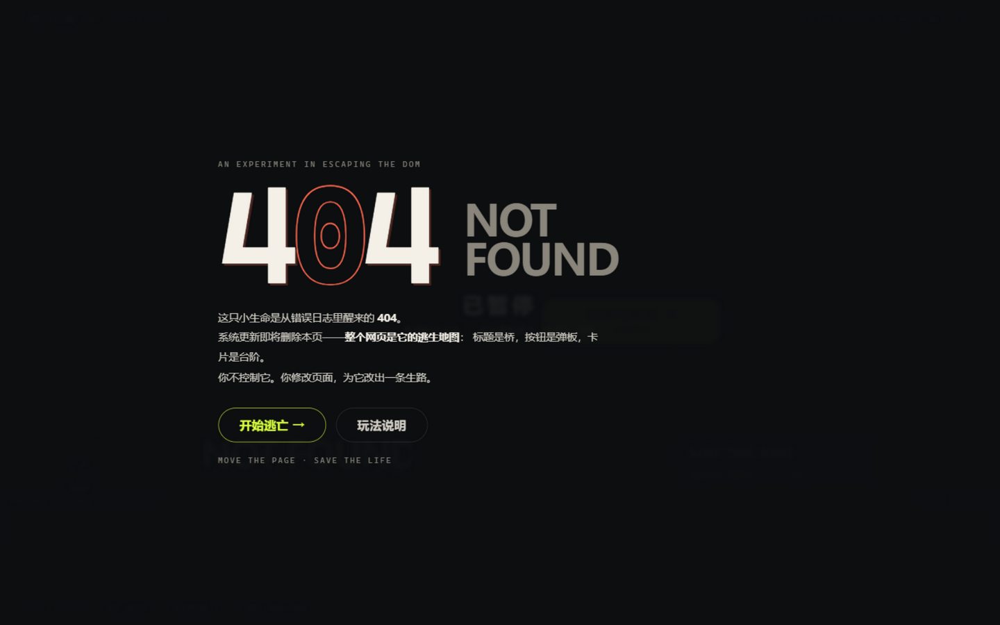
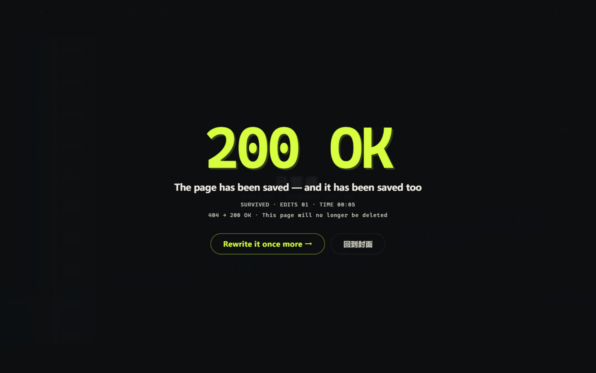

# RE:FLOW 404 · 别把我排版掉

> **整张网页就是逃生地图。拖动真正的标题、按钮和卡片，改变页面排版，在清理程序追来前，救出一个即将被删除的 404 小生命。**
>
> 机制宣言：**改排版 = 改地形；页面元素 = 物理实体；真正的 DOM 交互 = 游戏行动。**

2026 WaytoAGI 1024 游戏赛道参赛作品 · 纯前端网页游戏 · 打开即玩 · 无需登录 · PC 横屏旗舰 + 手机竖屏完整可玩 · 运行时**零依赖**（生产包 gzip ≈ 15.6KB）

---

## 目录

- [游戏是什么](#游戏是什么)
- [怎么玩（完整手册）](#怎么玩完整手册)
- [三幕关卡详解](#三幕关卡详解)
- [声画系统：排版即编曲](#声画系统排版即编曲)
- [底层架构设计](#底层架构设计)
- [核心实现细节](#核心实现细节)
- [工程与测试](#工程与测试)
- [目录结构](#目录结构)
- [快速开始](#快速开始)
- [设计文档与边界声明](#设计文档与边界声明)

---

## 游戏是什么

凌晨 04:04，一只不该存在的小生命从网页的错误日志里醒来——它的出生证明是一个 `404`。系统即将更新，过期页面都要被"归档清除"。它发现了一件对用户不可思议的事：**网页上的文字，对它来说是可以站立的建筑。**

你不是勇者，也不是 BOSS——你是页面的**临时排版管理员**。你不控制它的身体（它自己会向右逃命），你只做一件事：**修改这张真实的网页，为它排出一条生路。**

|  |  |
| --- | --- |
|  |  |
| *桌面首屏：左品牌海报栏 + 右深墨舞台* | *通关演出：404 → 200 OK 真实 DOM 重排* |
|  | |
| *手机 390×844：海报栏折叠 + 触屏锚点输入* | |

**一句话卖点**：你玩过的游戏里，UI 是游戏的外壳；这个游戏里，**UI 就是地形本身**——不是 Canvas 里画出来的假 UI，是真正的 `<h1>` `<button>` `<article>`，碰撞矩形来自浏览器 `getBoundingClientRect()` 的实时测量。你把"CONTINUE →"按钮拖到断崖中间，那个按钮就真的变成桥。

---

## 怎么玩（完整手册）

### 基本循环（10 秒学会）

```
你看到：  小精灵 ──自动向右跑──→ 断崖 ✕ …… 远处出口 SAVE
你做：    按住网页模块右上角的 ≡ 手柄，拖到虚线锚点，松手
发生了：  模块真的移过去 → 小精灵跳上去 → 白色清理波在身后吞掉旧页面
```

### 操作方式（三种等价输入）

| 平台 | 主输入 | 备选 | 键盘 |
| --- | --- | --- | --- |
| PC | 鼠标按住 **≡ 手柄** 拖动 → 松手吸附 | **点一下模块本体** → 浮出锚点按钮列表 → 点选落位 | `Tab` 聚焦手柄 · `Enter` 开始拖 · 方向键选锚点 |
| 手机 | **点一下模块** → 锚点按钮浮出（44px 命中）→ 点选 | 长按 ≡ 手柄拖动 | — |

全局快捷键：`SPACE` 暂停 / `R` 重试当前幕 / `M` 静音开关 / `Esc` 取消或关面板。

### 关键规则

1. **你不控制它**。零四永远向右跑、遇断崖自动起跳。你的全部影响力来自"把什么模块放到哪里"。
2. **拖动时世界 0.22× 慢放**——注意：追兵也一起慢（公平），但不会暂停，你依然有时间压力。
3. **吸附锚点制**：松手时模块吸附到最近的虚线锚点（30 单位内）；放到无效位置会轻摇弹回原位，**不扣任何东西**——试错免费。
4. **每次有效编辑计 1 次 EDITS**（拖回原位/取消不计）。三幕各有参考解，**全程最少 3 次编辑可通关**——试试挑战它。
5. **白色清理波**从左侧推进（速度逐幕加快：36 → 42 → 50 单位/秒）。被追上、或掉进排版断层（虚空）= 失败。失败原因会明确写出来。

### 模块的四种"物理语法"

| 模块 | 它在网页里是什么 | 它在小精灵眼里是什么 | 特性 |
| --- | --- | --- | --- |
| **标题** `NOT FOUND` | 真的 `<h1>` | 稳固的**桥** | 宽大可靠，但占地方 |
| **按钮** `CONTINUE →` | 真的 `<button>`（可点击） | **弹跳板** | 踩上去弹起（比普通跳跃更高更远），0.5s 冷却 |
| **面板** `ARCHIVE` | 真的 `<article>` + 折叠钮 | 可**折叠**的平台 | 点右上角 ⇕ 折叠/展开，真实改变高度 |
| **布局开关** `LAYOUT` | 真的 `aria-pressed` 切换按钮 | **整体地形重排** | 第三幕：5 块网页模块从"杂志目录"重排成"逃生阶梯" |

### 失败与成功

- **失败**（结算页直接写明原因）：`清理波追上了它` / `它掉进了断裂的排版` —— 一键"从这一幕重试"，前面的进度不丢
- **成功**：小精灵抵达 SAVE 出口 → 4 秒可跳过的 `404 → 200 OK` 真实 DOM 演出 → 结算显示 生还 / 编辑数 / 用时 / **你这一局排出的乐句**

---

## 三幕关卡详解

> 世界坐标 1200×620。每一幕都经过单元测试的数学证明：**不编辑必败、参考解必胜、存在多条合法路线。**

### 第一幕 · 标题之桥（STEP 01/03）

断崖间有一块初始放错位置的"CONTINUE →"按钮（悬在半空够不着的地方）。把标题当桥，把**按钮拖到正确的锚点**，小精灵踩上按钮 → 弹起 → 越过整个断层。

- 参考解：1 次编辑（按钮 → 中层锚点）
- 高阶路线：把按钮放到"看起来更好"的高处锚点会触发**二段弹跳**——风险更大但也通
- 清理波 36/s，延迟 2.5s

### 第二幕 · 弹跳阅读（STEP 02/03）

中间立着一堵 `DELETE` 删除墙（普通跳跃跳不过去）。**按钮初始位置弹不过墙**——把它拖到墙前的起跳锚点，借弹跳力越过墙、落到档案面板上；面板可以折叠成低坡收尾。

- 参考解：1 次编辑；稳妥路线 2 次（标题右移 + 按钮右移）
- 清理波 42/s——这一幕开始，"什么时候松手"本身成为决策

### 第三幕 · 响应式风暴（STEP 03/03）

5 块网页模块以"杂志目录"（gallery）布局散落——**没有任何连续路径**。点击右上角 `LAYOUT` 开关，整组真实 DOM 模块**重排成阶梯**（bridge），路就出现了。切早了浪费、切晚了小精灵会从缩走的平台上掉下去——时机就是一切。

- 参考解：1 次编辑（切 LAYOUT）；开局切 / 上到第一块后再切都赢，太晚切则败
- 清理波 50/s，延迟 2s

### 通关演出

```
t=0.4s  [跳过演出 ⏭] 出现            t=1.6s  零四跳进新 LOGO + 救援乐句响起
t=0.6s  "404" 活字分离                t=2.6s  SURVIVED —— 战绩逐行浮现
t=1.1s  DOM 重排成 "200 OK"           t=3.2s  [再改写一次] [挑战更少编辑] [♪ 再听一次我的页面] [分享战绩]
```

---

## 声画系统：排版即编曲

> v4 的核心表达：**DOM 是地形，也是乐器。改布局就是改配器。**（不是节奏游戏——不跟拍、不判拍，音乐只随你的有效编辑演化）

### 音乐如何随你的操作生长

| 你的编辑 | 音乐里发生什么 |
| --- | --- |
| 开始逃亡 | 氛围垫 + 脉冲低音（A 小调 112 BPM）启动 |
| 摆好一个**标题** | 下一小节加入**低音拨弦**声部 |
| 摆好一个**按钮** | 下一小节加入**钟琴动机**（A-C-E-B 四音品牌动机逐小节推进） |
| **折叠**一个面板 | 下一小节加入**纸页打击**声部 |
| 切换**布局** | 和声**开阔化**（叠加 C 大调色彩） |
| 清理波逼近 | 危机金属 tick 进入（300ms 滞回，靠配器密度而非音量吓人） |
| 失败 | 全部循环停止，只剩 350ms 低沉纸片落地 |
| 通关 | **把你在本局激活的声部合成 3–5 秒专属救援短句**（动机完整陈述 + C 大调解决），结算页可回放 |

全部由 **Web Audio API 程序合成**（振荡器/噪声/滤波器），零音频文件、零 CDN。默认**静音**，点 `♪ 开启声音` 后才播放（浏览器自动播放策略友好）；三总线音量（总/音乐/音效）可调；**静音 100% 可玩**——声音永不影响胜负。

### 视觉语言：暖纸杂志外壳 + 深墨舞台

- 外壳 `#EEEAE1` 纸面 + 品牌朱砂 `#EE5337`（只做品牌，不做状态色）
- 舞台 `#0C0E10` 墨底，**可操作 = 酸柠 `#D9FF48`**、危险 = `#FF6B52`——颜色永远伴随形状/文案/边界变化，不靠红绿单独表意
- 首屏 404 带 ±2px 印刷对位误差；拖拽时模块抬起 4px（纯视觉包裹层）、吸附 130ms 回弹、无效放置单次 2px 轻摇——每一下都有物理感，但不惩罚

---

## 底层架构设计

### 分层总览

```
┌─────────────────────────────────────────────────────────────┐
│  index.html  暖纸外壳（header / 品牌栏 / 舞台容器 / 结算层）      │
├─────────────────────────────────────────────────────────────┤
│  main.ts        主循环 + 状态机 + 输入 + 屏幕流                │
├──────────┬──────────────────────┬───────────────────────────┤
│ bridge/  │      game/           │  ui/ + effects/           │
│ DOM 世界桥 │   纯逻辑引擎（权威）    │   声音 + 角色渲染            │
│          │                      │                           │
│ DOMWorld │  engine.ts           │  AudioDirector            │
│ Bridge   │   物理积分/单向碰撞     │   112BPM 传输层/声部/冷却     │
│ Coordinate│   自动跳跃规划器       │  CharacterRenderer        │
│ Mapper   │   清理波/拖拽锚点       │   零四/清理波/粒子（Canvas）  │
│          │   网格重排动画         │                           │
│ levels.ts │   三幕关卡数据        │                           │
└──────────┴──────────────────────┴───────────────────────────┘
        ↑ 测量喂入 rect                ↓ 只读事件
   真实 DOM（h1/button/article/footer）= 物理平台
```

**三条铁律**（保证"真 DOM 即物理"不变成营销话术）：

1. **引擎不 import DOM**——`game/` 是纯 TypeScript，只认 `Rect[]` 数据，可以在 Node 里完整跑一局（单元测试就是这么验证可解性的）
2. **碰撞权威 = DOMRect 测量**——每帧 `measurePass()` 把 `getBoundingClientRect()` 折算成世界坐标喂给引擎；引擎算出的落地判定永远对应你眼睛看到的真实元素位置
3. **表现只消费事件**——音频/粒子/屏幕流订阅引擎事件，谁也不回写物理状态；动画再花哨也改不了胜负

### 关键数据流：一次拖拽的完整旅程

```
pointerdown（≡ 手柄）
  → DOMWorldBridge.attachDrag
  → engine.beginDrag(moduleId)          验证 phase=RUNNING / 未锁 / 名额
  → phase = DRAGGING（全局 timeScale 0.22）
pointermove
  → CoordinateMapper.deltaToWorld()     client px → world 单位（不猜比例）
  → engine.previewDrag(dx, dy)          引擎权威矩形实时更新（含边界钳制）
  → renderPass() 把 preview 写回元素 transform
  → 期间 measurePass 对其它模块照常测量；被拖模块的碰撞 = 引擎预览值
pointerup
  → engine.finishDrag()
      最近锚点 ≤30 单位？ → 吸附、anchorIndex 更新、edits+1 → 事件 DRAG_SNAP
      否则               → 回弹原锚点，不计编辑          → 事件 DRAG_CANCEL
  → DRAG_SNAP → AudioDirector.onValidEdit(action)
      声部 pending，下一小节边界生效（绝不重复叠加）
  → 首次救援 → 零四回头「← 谢谢」（每局限 1 次）
```

### 物理引擎（`src/game/engine.ts`，纯 TS）

- **固定步进 1/60s + 累加器**：主循环按真实帧差累积，`tick(fixedStep × timeScale)` ——慢放对角色和清理波一视同仁（规格硬要求）
- **单向平台碰撞**：仅"上一帧脚底 ≤ 平台顶 && 本帧 ≥ 平台顶 && 水平重叠 ≥ 8 单位"才落地；从下方上穿不撞头——这让"把标题拖到脚下"不会把小精灵挤死
- **抛物线自动跳跃规划器**：每 tick 检测距站台右缘 ≤14 单位时，对前方所有平台解二次方程 `feetY(t) = y0 + vy·t + ½g·t²` 求下降段交点，落点 x 必须落在目标平台 ±容差内才起跳；无解则边缘犹豫 0.45s（显示 `!`）后继续跑（可能坠落）——**跳与不跳由物理决定，planner 不能传送角色**
- **携带物理**：小精灵站着的平台被拖动/重排时，按平台位移增量带动角色（每步 ±120 单位限幅防穿墙）
- **平台携带的网格重排**：第三幕 5 块块状平台的"杂志→阶梯"过渡是引擎内的 0.26s ease-expo 插值动画（DOM 同步展示）。为什么不用 CSS transition？因为后台标签页 `left/top` 过渡会冻结，测量会把物理覆写回旧布局——这是实测踩过的坑，已写进 LEVEL_SOLVABILITY.md
- **胜负裁决优先级**：出口过线 > 清理波追上 > 坠入虚空；FAIL 后世界冻结、只结算一次

### DOM 世界桥（`src/bridge/`）

- **`DOMWorldBridge`**：把关卡数据注入成真实 DOM（`<h1>/<button>/<article>` + `<footer>` 平台 + 网格块），统一 measurePass/renderPass 分离读写（避免每帧强制重排）；拖拽手柄 Pointer Events + `setPointerCapture`；**锚点浮层**（点模块→选锚点）走与拖拽**同一条引擎状态机路径**（beginDrag→preview→finishDrag），所以点击输入与拖拽输入的计分/声部/事件完全一致
- **`CoordinateMapper`**：client ↔ world 唯一换算入口。世界面固定 1200×620 CSS px，外层用 `transform: scale()` 适配；所有换算基于 `getBoundingClientRect()` 实测比例，DPR/窗口缩放/旋转天然正确（有单测覆盖）
- **手机镜头**：竖屏时按比例缩放 + `translateX(-camX)` 跟随角色（lerp 平滑），页面本体永不横向滚动

### AudioDirector（`src/ui/AudioDirector.ts`）

- **传输层**：112 BPM（beat=0.5357s），50ms `setInterval` 轮询 + 140ms lookahead 用 `audioCtx.currentTime` 精确调度——参照 Web Audio ahead-scheduling 最佳实践
- **声部状态机**：`pending` 队列只在**小节边界**应用到实际调度（`beatIndex % 4 === 0`），保证一次编辑不会把同一个声部触发两遍
- **事件音效冷却表**：hover 300ms / land 80ms 去重 / preview 150ms / invalid 600ms / grab 每拖一次……全部按规格事件表实现，杜绝"机关枪音效"
- **总线**：master(0.65) / bgm(0.35) / sfx(0.65) + DynamicsCompressor 限幅；静音 = master gain 归零 + 停止传输层，**立即无声且不影响游戏**
- **生命周期**：默认静音 → 用户点击 `♪` 手势内 `AudioContext` resume；`visibilitychange` suspend（回来不自动响，需主动继续）；重开一局 `resetRun()` 复位声部但保留音量设置
- 全部音色（氛围垫/拨弦/钟琴含泛音/纸噪/危机 tick）由振荡器+噪声+滤波器合成，**零音频资产**

### CharacterRenderer（`src/effects/`）

Canvas 2D 透明覆盖层（`pointer-events:none`，z-index 高于 DOM 模块）——**只画三类东西：零四、清理波、粒子/锚点幽灵**。绝不画平台（平台必须是真 DOM，这是本作的身份）。

零四（Zero-Four）的五个识别锚点：折起的页面角轮廓 / 右上 `>` 缺口随跑动张合 / 错位双眼不同步眨眼 / 朱砂短腿跑动摆动 / 落地 squash & stretch。32×32 缩小后仍可辨认。

---

## 工程与测试

```bash
npm install
npm run dev       # 开发服务器
npm run test      # 30 项 Vitest
npm run build     # tsc --noEmit + vite build
npm run preview   # 预览生产构建
```

### 30/30 测试覆盖什么

**物理不变量（17 项）**：单向平台（重叠<8 不落地/下方上穿不撞头）、土狼时间 90ms、抛物线求解数学（对称距离 158.3 断言）、过高/过远不可达、弹跳 0.5s 冷却、拖拽 0.22× 慢放、清理波单次结算、出口优先级、坠空 FAIL、吸附计分（合法 1 次/原槽 0 次/取消 0 次）、pointercancel 回原槽、平台携带、面板折叠、网格重排插值、锚点可达。

**三幕可解性（13 项）**——用**真实引擎跑完整一局**证明：
- 每幕"不编辑 → 必败"（编辑是必需的，不是装饰）
- 每幕"参考解 → 必胜"（含用时区间断言，如第一幕 4–25s）
- 多路线存在（第一幕第二锚点、二段弹跳高阶路线）
- 第三幕切换时机敏感（1.5s 后切仍胜 / 3.2s 后切败）
- 确定性：同输入同轨迹哈希一致

### 已实测（浏览器，Chromium）

- 真实 PointerEvent 拖拽手柄：吸附 (555,416)、edits 计数、慢放、无效回弹
- 锚点点击输入：纯点击通关三幕 → VICTORY → 200 OK 演出 → 挑战/回放/分享按钮
- 声部解锁与编辑类型一一对应（按钮×2+网格 → bellMotif+openHarmony，未编辑类型不解锁）
- 手机 390×844：CTA 48px 首屏可见、无横向滚动、镜头跟随、模块可点
- 失焦自动暂停（世界+音乐一起冻结）

### 未验证（如实声明）

iOS Safari / Android 真机、6 人盲测、音频人耳评审——详见 `docs/LEVEL_SOLVABILITY.md` 与 `docs/V4_UPGRADE.md`。

---

## 目录结构

```
reflow-404/
├─ index.html                  # 暖纸外壳 + 舞台容器 + 结算演出层
├─ src/
│  ├─ main.ts                  # 主循环（固定步进）/ 场景流 / 输入 / 结算演出
│  ├─ styles/main.css          # 全部样式（v4 tokens / 双色调 / 手感动效 / 响应式）
│  ├─ game/                    # ★ 纯逻辑引擎（不 import DOM）
│  │  ├─ types.ts              #   GameState/Module/LevelDef 类型
│  │  ├─ levels.ts             #   物理常量 + 三幕关卡数据（含锚点/参考解）
│  │  └─ engine.ts             #   物理积分/跳跃规划/清理波/拖拽/面板/网格重排
│  ├─ bridge/                  # ★ DOM ↔ World
│  │  ├─ CoordinateMapper.ts   #   client ↔ world 唯一换算入口
│  │  └─ DOMWorldBridge.ts     #   模块注入/每帧测量/拖拽/锚点浮层
│  ├─ effects/
│  │  └─ CharacterRenderer.ts  #   零四 + 清理波 + 粒子（Canvas 2D）
│  ├─ ui/
│  │  └─ AudioDirector.ts      #   112BPM 传输层/声部/事件冷却/乐句回放
│  └─ utils/storage.ts         #   localStorage 安全封装
├─ tests/
│  ├─ physics.test.ts          # 17 项物理/交互不变量
│  └─ levels.test.ts           # 13 项三幕可解性 + 确定性
├─ docs/
│  ├─ CHARACTER_CARD.md        # 主角卡（设定/识别锚点/AI 制作说明）
│  ├─ character-card/zero-four.svg
│  ├─ LEVEL_SOLVABILITY.md     # 可解性验证 + 调参记录 + 已知限制
│  ├─ ASSET_LICENSES.md        # 素材授权（零外部素材声明）
│  └─ V4_UPGRADE.md            # v4 声画升级实施记录
└─ artifacts/                  # 实机截图
```

---

## 快速开始

```bash
git clone https://github.com/qing1989620/game-1.git
cd game-1
npm install
npm run dev        # → http://localhost:5173
```

构建部署：`npm run build` 产出 `dist/`（`base: './'` 相对路径，任意静态托管子路径可用），Vercel / Netlify / Cloudflare Pages / GitHub Pages 拖上去即玩。

---

## 设计文档与边界声明

- 设计依据：《RE:FLOW 404 旗舰级网页游戏设计与开发总纲 v3 + v4 声画交互/留存体验规范》（研发规格书，随参赛材料提交）
- **原创性**：全部视觉（DOM 世界/角色/粒子）与音频（Web Audio 合成）为代码原创绘制，零外部图片/音频/字体文件；主角设定图 `zero-four.svg` 为程序化绘制（已在 CHARACTER_CARD.md 如实标注，不以 SVG 冒充 AI 生成图）
- **诚实边界**：本文所有"已验证"均来自真实浏览器操作与 30/30 单测；未做的测试（真机/盲测/人耳评审）如实标注在 docs 内，不以预期冒充结果

> **MOVE THE PAGE · SAVE THE LIFE —— 这次主角不是英雄，是那条一直被消耗的 404。**
