# RE:FLOW 404 · 断点之城｜新手图文玩法

你扮演头部有缺口圆环的「零号」，先帮 MIRA 找回被列车跳过的 B 站，再乘城际列车前往脉冲炉，让晴雨与进位重新推动城市。

**这篇说明可以直接发给第一次玩的朋友。不需要写代码：走到目标旁边，扫描，再操作事件卡、线路、天气与接线端口。** 当前 V6.1 开放 **2 / 8 座城市：指针港、脉冲炉**；其余六城为后续规划。

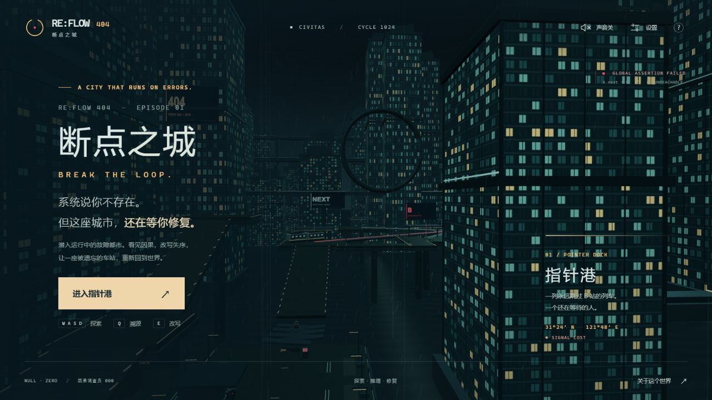

[打开游戏](#start) · [关键按键](#keys) · [第一城图文](#walkthrough) · [第二城图文](#forge) · [天气怎么玩](#weather) · [手机操作](#touch) · [卡住怎么办](#help) · [开发与验收](#development)

<a id="start"></a>

## 先把游戏打开

### 已经有人帮你启动了游戏

在**运行游戏服务的那台电脑**上，打开 [本地正式预览：http://127.0.0.1:5387/](http://127.0.0.1:5387/)。

**发给朋友时请注意：`127.0.0.1` 指的是打开链接的那个人自己的电脑。** 把这个链接发给另一台电脑，并不能让对方访问作者的电脑。朋友可以按下面的方法在自己电脑启动，或使用维护者另行提供的公开试玩地址。

当前的[在线部署地址](https://reflow-404-breakpoint-city-1024.amber-haven-4753.chatgpt.site)仍是**仅所有者可访问的私有站点**。朋友遇到无权限或 403 时，可先按本地启动步骤体验。

### 第一次在自己电脑启动

1. 准备 **Node.js 24 或更高版本**。
2. 在本仓库页面点击绿色 **Code → Download ZIP**，解压。
3. 进入能看见 `package.json` 的文件夹，打开终端。Windows 可以在该文件夹的地址栏输入 `cmd` 后回车。
4. 依次执行：

```sh
npm ci
npm run dev -- --host 127.0.0.1 --port 5386 --strictPort
```

5. 保持终端运行，在浏览器打开 **[http://127.0.0.1:5386/](http://127.0.0.1:5386/)**。

首次下载依赖需要联网。关闭运行服务的终端后，本地链接也会停止响应。请通过上述网页地址进入游戏。

<a id="keys"></a>

## 先记住这几个操作

**最常用的是：WASD 走路 → Q 扫描 → E 交互 → 修改方案 → R 验证。**

| 你想做什么 | 电脑上怎么操作 |
| --- | --- |
| 向前、向左、向后、向右走 | 按住 **W、A、S、D**；方向键也可以 |
| 看向别的方向 | **按住鼠标右键并拖动**；只移动鼠标不会转镜头 |
| 跑快一点 | 移动时按住 **Shift** |
| 跳一下 | **空格 Space** |
| 看见异常的线索 | 靠近目标后按 **Q**，或点击底部「溯源」 |
| 对话、打开编辑面板、登车 | 看到画面中间的 **E 提示**后按 **E**，或直接点击提示 |
| 按当前方案实际运行一次 | 在编辑面板中按 **R**，或点金色「重放并验证」 |
| 看地图 | **M / Tab**，或点击右下角小地图 |
| 切换晴雨 | 右上角「**晴天 / 雨天**」，或按 **T** |
| 退出编辑 / 暂停 | **Esc**；正在编辑时先退出编辑，再按一次可打开暂停菜单 |
| 打开说明、声音和画面设置 | 右上角 **?、喇叭、设置**按钮 |

> **预演 / 检测是先看看结果；真正完成修复，需要点击金色验证按钮。** 指针港的断点会冻结局部时间。脉冲炉的天气工作台会持续蓄能、漏电与散热；打开暂停菜单才会冻结设备。

<details>
<summary><strong>只想先过关？点这里看最短操作清单（含答案）</strong></summary>

1. 首页点「进入指针港」。
2. 向前走到左侧 MIRA 附近，出现「E 与 MIRA 对话」后按 E。持续点「继续」或按 E，直到对话结束、获得因果织针。
3. 再向前走到「Q-01 / 事件失序」附近，按 **Q，再按 E**。
4. 把「让旅客离开」移到第一位，排成 **让旅客离开 → 移除旧站台 → 保存生还记录**。点「重放并验证」。
5. 等维修通道展开，沿桥和长坡向前走到 **A 站**，再按 **Q、E**。
6. 在面板上排「源节点」选 **A**，下排「连接到目标站」选 **B**。确认中间显示 **A.next → B**，再点「重放并验证」。
7. 修复镜头结束后，在 **A 站列车旁再按一次 E 登车**。等列车抵达终点，出现 **200 OK** 即完成第一城。
8. 点「**乘城际列车出发**」，进入脉冲炉。向前找到 **K-13**，按 E；再靠近集电台按 Q、E。
9. 选择 **晴天**，让隔离闸保持打开；充到 **80% 以上**后，点「隔离闸开着 · 点此关闭」。
10. 再选 **雨天**，等温度降到 **35°C 以下**，点「验证并接入」。
11. 沿展开的通道和两段坡道上行，到塔底按 Q、E。选择 **CARRY / 产生进位**，点「重放并验证」。
12. 向前走上圆形升降台，按 E 乘梯。到塔顶出现第二次 **200 OK**，完成第二城。

找不到按钮时，把鼠标放进工作台面板内向下滚动。想自己探索，可先收起这份清单，再看下面的分步图。

</details>

<a id="walkthrough"></a>

## 照着图，从开始走到通关

下面的图片均为 V6 游戏实际运行截图。窗口较窄时，编辑面板会移到画面底部；按钮名称和解法相同。可以点击 GitHub 中的图片放大查看。

### 第 1 步：找到 MIRA，拿到因果织针

首页第一次玩点 **「进入指针港」**。如果已经有进度、想接着上次玩，选择 **「继续旅程」**。

进入后先看这张图：

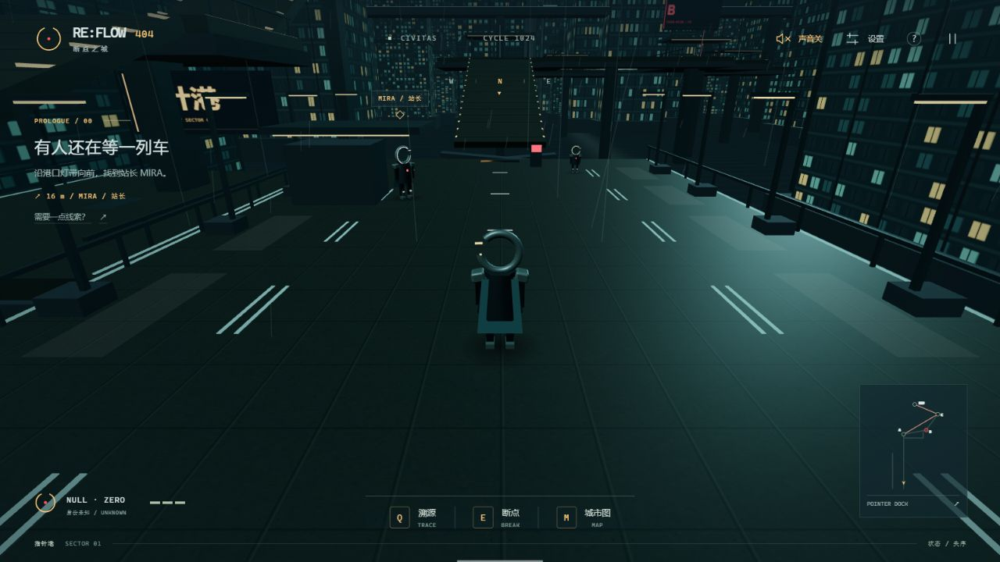

- **左上角任务文字**告诉你下一步做什么。
- **场景中的菱形标记和名字**指向目标。第一位目标是左前方雨棚下的 **MIRA / 站长**。
- **画面中间出现的 E 提示**表示已经靠近，可以交互。
- 右下角小地图可以点开；迷路时也能按 **M**。

按住 W 向前走。看到下面的「**E 与 MIRA 对话**」时，按 E 或直接点击它。

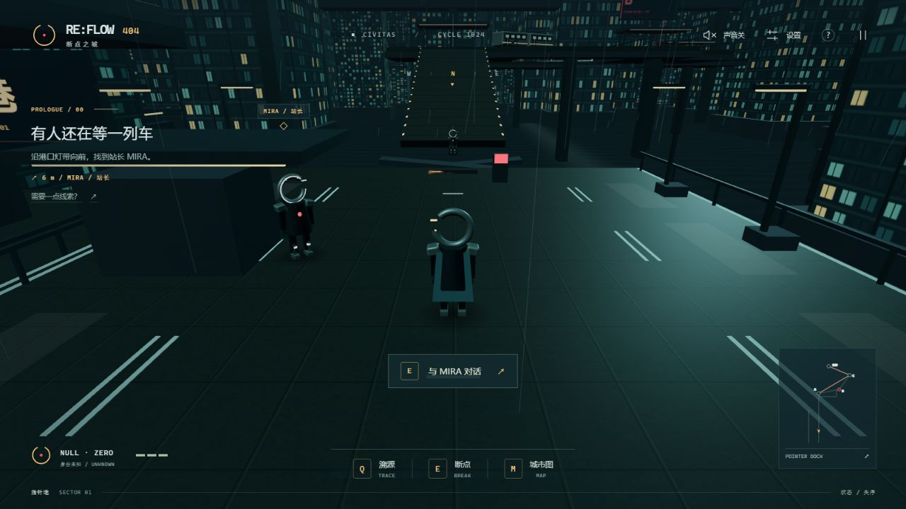

读完每段对话，点 **「继续」**或再按 E，直到对话框消失。看到「**获得因果织针**」或左下角「**因果织针 / 已连接**」，这一步就完成了。

**下一步的任务会变成「先离开，再消失」。**

### 第 2 步：修好提前消失的站台

继续向前，靠近 **「Q-01 / 事件失序」**标记。先按 **Q** 扫描，再按 **E** 打开工作台。

故障的原因是：**站台先被删除，旅客还没有来得及离开。** 你要调整左侧的三张事件卡片。

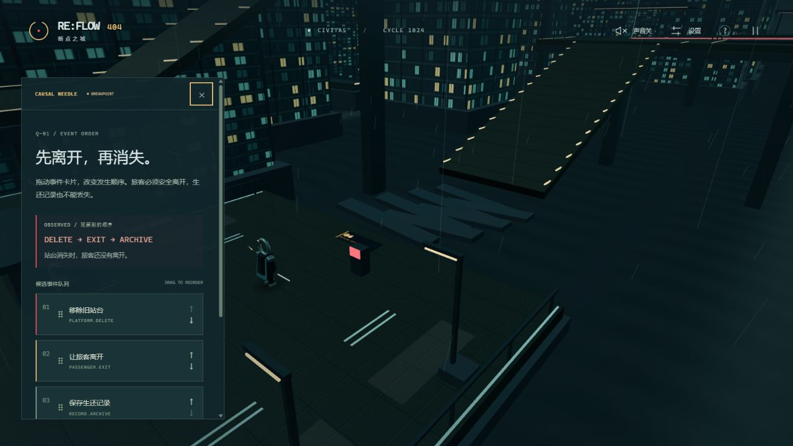

按下面的顺序排列「**候选事件队列**」：

```text
01 让旅客离开       EXIT
02 移除旧站台       DELETE
03 保存生还记录     ARCHIVE
```

最容易的操作是：找到「**让旅客离开**」这一行，点它右侧的 **↑ 上移一次**。也可以抓住卡片左边的 **⠿ 拖柄**，把它拖到第一位。

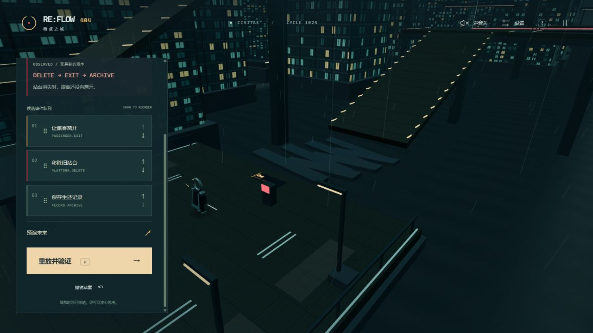

**看清楚两个区域：上方「观察到的顺序」保留的是原始故障记录；你要检查的是下方编号 01、02、03 的候选队列。** 上方仍显示 DELETE 开头，不代表操作没生效。

排好后，点面板下方金色 **「重放并验证」**，或者按 **R**。如果按钮不在视野里，**把鼠标放在左侧面板内向下滚动**。

通过后会播放「先让一个人，安全离开」的镜头，维修通道随之展开。可以等镜头结束，也可以点「跳过镜头」。

**下一步的任务会变成「一座被跳过的车站」。**

### 第 3 步：沿维修桥和长坡走到 A 站

恢复操作后，沿前方接通的维修桥前进，再走上带灯带的长坡，跟着 **「DS-01 / 失联线路」**标记到高架 A 站。这段主线路可以正常走上去，无需精确跳跃。

到了上层站台，在标记附近按 **Q** 扫描。看到「**E 打断点 · 检查列车指针**」后，再按 E。

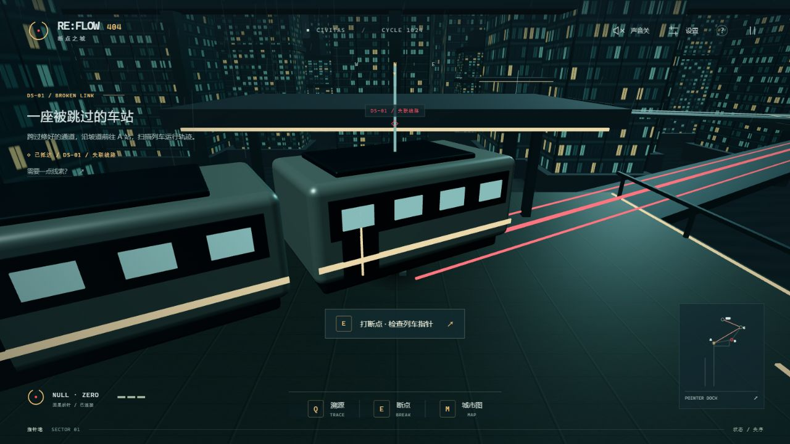

此时的线索是：

```text
实际停靠：A → C → END
B 站仍有人等车，但列车把它跳过去了。
```

左侧通往观景台的坡道属于可选探索。本次先跟着 A 站的任务标记走即可。

### 第 4 步：把 A 的下一站接到 B

进入工作台后，会看到 A、B、C、END 四个车站。**A.next 的意思就是「从 A 出发，下一站去哪」。**

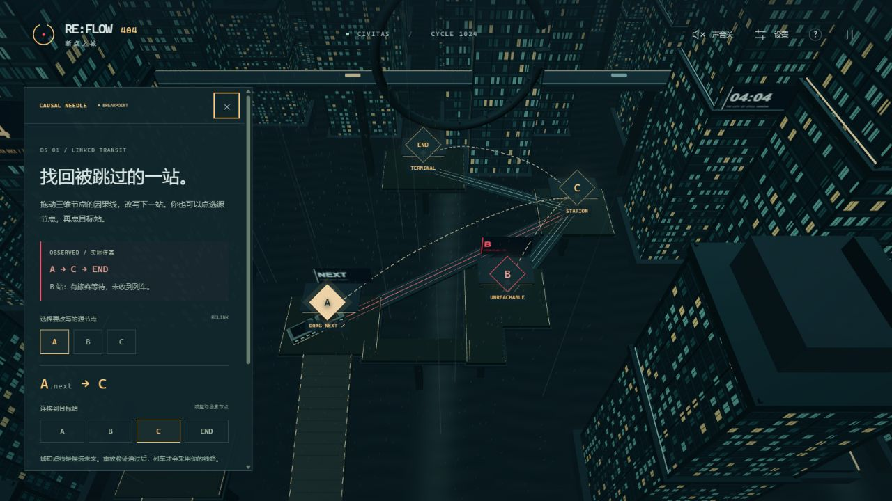

第一次玩，建议直接用左侧的两排按钮：

| 在哪里点 | 点哪个 | 表示什么 |
| --- | --- | --- |
| 上排「选择要改写的源节点」 | **A** | 从 A 站出发 |
| 下排「连接到目标站」 | **B** | 下一站去 B |
| 中间的方案文字 | 检查显示 **A.next → B** | 已经选好这条连接 |

B 到 C、C 到 END 的初始连接可以沿用。选完后应像这张图：

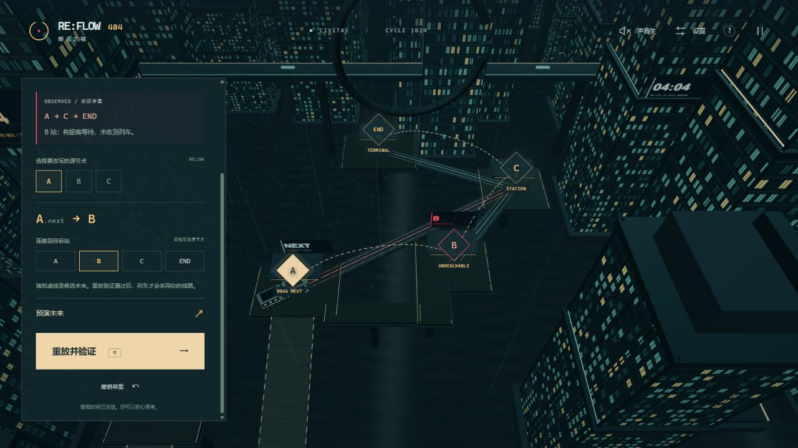

然后点金色 **「重放并验证」**，或按 **R**。

> 上方「实际停靠 A → C → END」仍是修复前的证据。请以中间的 **A.next → B** 检查当前方案，再提交验证。

<details>
<summary>想用场景中的三维连线来操作？</summary>

从画面中的 **A 菱形节点**按住鼠标左键，拖到 **B 菱形节点**后松开。检查左侧是否显示 **A.next → B**，再按 R 验证。

第一排按钮也可以先选好源 A，再点击场景里的 B 节点。琥珀色虚线表示尚未提交的方案。

</details>

正确后，列车会按 **A → B → C → END** 重放，B 站恢复，任务更新为 **「带她回家」**。

### 第 5 步：回到 A 站列车旁，按 E 登车

**看到 B 站恢复后，还要完成一次登车返航，才会进入结算。**

修复镜头结束后，你会回到 A 站列车旁。如果已经走开，按 M 看地图，回到 A 站即可。

看到下图中间的 **「E 登上返航列车」**，按 E 或直接点击它。

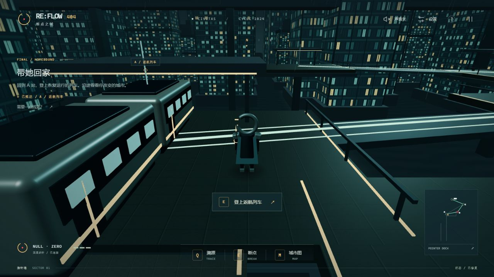

登车后，列车会自动经过各站，无需继续按方向键。等它抵达 END，出现 **「200 OK」**和「**系统找到了车站。她找到了回家的路。**」，本章就通关了。返航镜头也可以跳过。

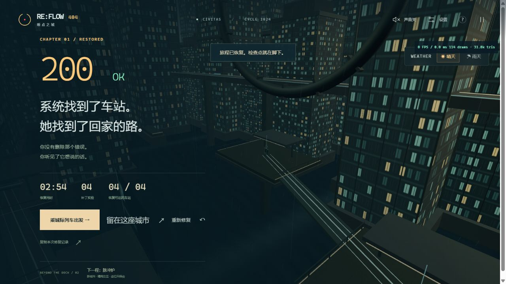

结算后的按钮：

| 按钮 | 用途 |
| --- | --- |
| 留在这座城市 | 在恢复后的指针港自由探索 |
| 重新修复 | 从初始故障重新开始一局 |
| 复制本次修复记录 | 把用时、实验次数和路线复制到剪贴板，便于分享 |

结算用时和实验次数会随你的操作变化。V6.1 首城结算新增「**乘城际列车出发**」。已通关的旧存档点「继续旅程」，也能在任务下方点「前往脉冲炉」，或到 END 站按 E。

<a id="forge"></a>

## 第二城：脉冲炉，借一场晴，再借一场雨

这里有铜色散热器、太阳能阵列、蒸汽、八层位环与真正会上升的电梯。**完成指针港返航后开放；第一城的修复记录会保留。**

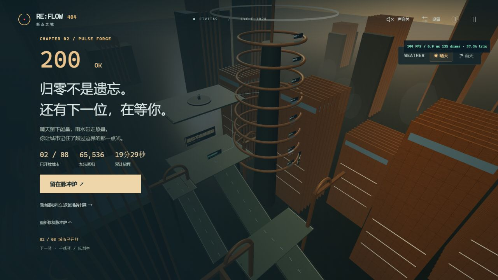

### 第 6 步：乘城际列车，找到 K-13

在第一城结算页点「**乘城际列车出发**」。如果已经回到自由探索，也能点击左上任务下的「前往脉冲炉」，或在 END 站按 E。

入城镜头结束后，沿中间的蓝色虚线向前走。左侧蓝色断环角色是 **K-13 / 热工师**。靠近按 **E**，任务会变成「借一场晴，再借一场雨」。继续到集电台附近按 **Q → E** 打开工作台。

<a id="weather"></a>

### 第 7 步：用天气接通稳态电源

设备需要同时满足：**储能 ≥72%、温度 ≤35°C、隔离闸关闭、雨天保电回归通过**。

| 天气 / 闸门 | 储能怎么变 | 温度怎么变 |
| --- | --- | --- |
| 晴天，闸门打开 | 每秒增加 12% | 每秒升高 4°C |
| 雨天，闸门打开 | 每秒漏掉 8% | 每秒下降 10°C |
| 闸门关闭 | 停止充电，同时保住已有电量 | 雨天仍能降温；晴天缓慢冷却 |

照着做即可：

1. 点「**晴天 / 蓄能**」。确认按钮显示「隔离闸开着」，保持它打开。
2. 看储能数字增长。到 **80% 以上**后，点「**隔离闸开着 · 点此关闭**」。
3. 确认按钮变成「**隔离闸已关闭**」，再点「**雨天 / 降温**」。
4. 等温度降到 **35°C 以下**。关闸后电量应该保持不变。
5. 点「检测当前状态」可先看报告；通过后点金色「**验证并接入**」提交。铜色通道才会实际展开。

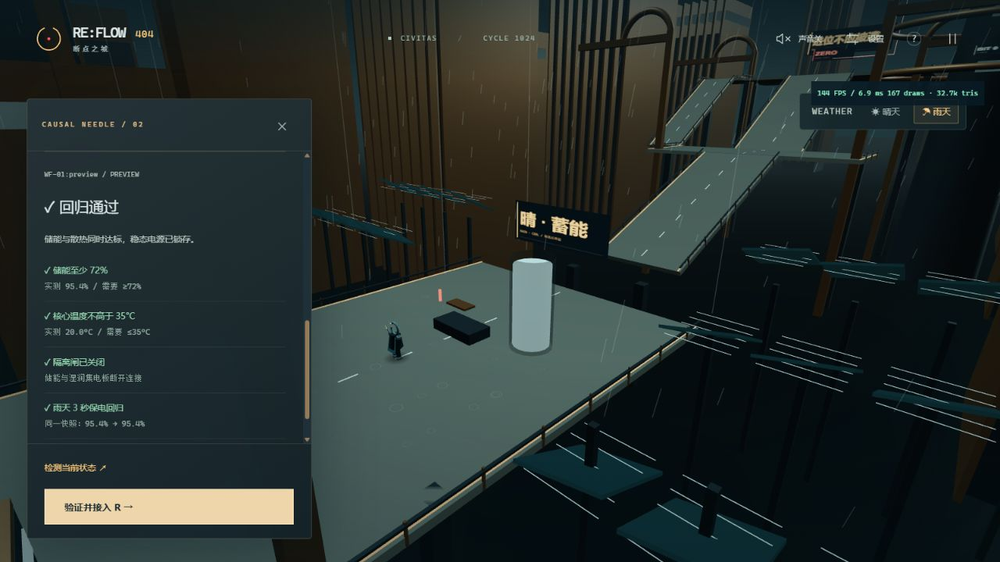

**这里的读数实时变化。** 报告保存你点按钮时的采样快照，实时数值在上方；想重新采样再点检测即可。按 Esc 关闭工作台后，设备也会继续运行；需要停下来时，再按 Esc 打开暂停菜单。

雨不会让角色打滑，也没有限时失败。做错了可以重新打开隔离闸、切晴天充电。供电验证成功后会锁存稳定状态，之后切换天气不会撤掉通道。

### 第 8 步：沿两段坡道，修复失忆电梯

沿亮起的铜色边线和蓝色中线直走，经过两段坡道，到 **CO-01 / 失忆电梯** 附近按 **Q → E**。

这台电梯把「结果为零」错当成「产生进位」：

| 例子 | 八位结果 | CARRY / 进位 | 电梯应该怎样 |
| --- | --- | --- | --- |
| 255 + 1 | 0 | 1 | 触发 |
| 0 + 0 | 0 | 0 | 静止 |
| 255 + 255 | 254 | 1 | 触发 |

第一次保持原始 **ZERO** 接线验证，会看到具体反例「**0+0：进位=false，电梯却触发**」。这表示“结果是零”和“发生进位”是两回事。

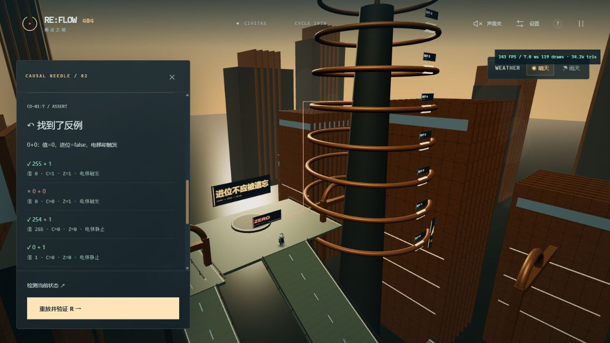

在工作台内找到三个接线端口，点 **「CARRY / 产生进位」**，确认它显示「已接线」，再点「**重放并验证**」。面板过长时在面板内滚动，电脑也可按 R。

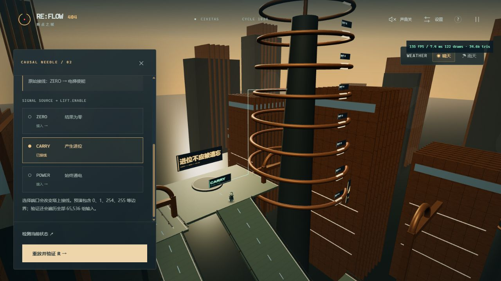

验证会检查全部 **65,536 组八位无符号加法**，包含正常输入和边界输入。检测通过后塔环恢复进位，任务会变成「让被遗忘的进位升起」。

### 第 9 步：乘升降台到塔顶，完成第二城

关闭工作台后继续向前，到塔底的**圆形升降台**，出现「**E 乘进位升降台**」时按 E。升降台会从 26 米升到 50 米，抵达塔顶后出现第二城的 **200 OK**。

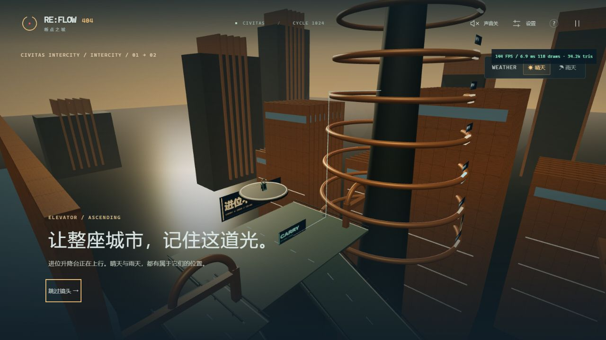

结算后可以「**留在脉冲炉**」观景、「**乘城际列车返回指针港**」，或只「**重新修复脉冲炉**」。最后一项只重开第二城，保留首城修复。

**两城都支持右上角晴雨切换。** 指针港会改变天光、雨线和路面雨圈；脉冲炉还会影响集电台的蓄能与散热。下面是同一城市全景在雨天的实机效果：

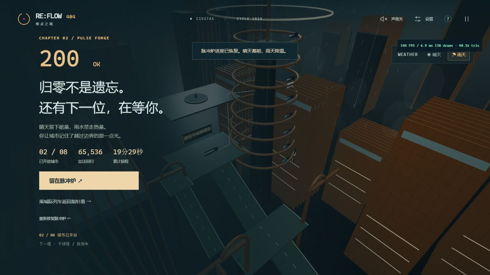

### 八城地图和跨城续玩

按 **M** 打开地图，可以在已开放的两城之间往返。第三至第八城清楚标注「规划中」；当前不能进入。离开第二城、刷新网页、下次点「继续旅程」，都保留两城已经验证的修复。

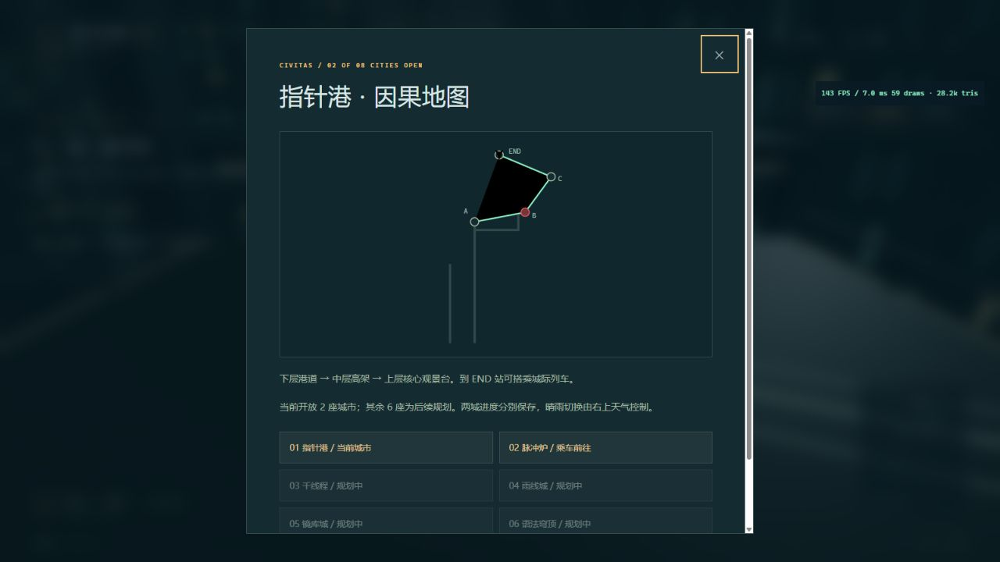

<a id="touch"></a>

## 手机上怎么操作

首次试玩建议先按上面的电脑步骤熟悉路线。手机采用同一套解法：

| 操作 | 手机上怎么做 |
| --- | --- |
| 移动 | 左下角摇杆往想走的方向推，松手停下 |
| 转动视角 | 在右半边空白画面拖动 |
| 跳跃 | 点右下角的向上箭头 |
| 扫描 | 点右下角「溯源」 |
| 对话、进入编辑、登车 | 直接点画面中间出现的交互提示 |
| 调整事件顺序 | 拖动卡片的 ⠿，或点卡片右侧的 ↑ / ↓ |
| 修改线路 | 上排选源 A，下排选目标 B |
| 验证 | 在底部工作台里点「重放并验证」 |

手机的编辑面板在画面底部，内容可以在面板里上下滑动。进入编辑后摇杆会收起；关闭面板后恢复移动。脉冲炉天气台的实时模拟会继续，点顶部暂停按钮才会冻结。

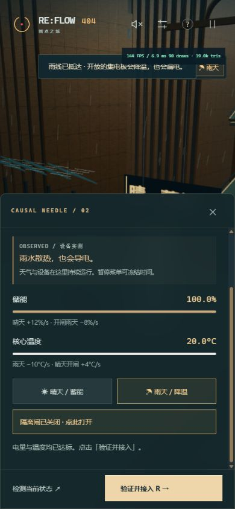

按键布局已经在 390×844 浏览器视口中验证，真实手机的性能与兼容性仍需继续测试。

<a id="help"></a>

## 卡住了，先看这里

| 你遇到的情况 | 怎么继续 |
| --- | --- |
| 按 W / E / Q 没反应 | 先点一下游戏画面。如果出现暂停窗口，点「继续旅程」；有对话框时先把对话继续完 |
| 按 E 没有编辑面板 | 先靠近菱形任务标记，等中间出现 E 提示；异常要先按 Q 扫描 |
| 提示先获取因果织针 | 回到 MIRA 附近，把开场对话进行到结束 |
| 鼠标移动但视角没动 | 按住**右键**再拖动 |
| 进入工作台后角色不走了 | 此时正在编辑，局部时间已冻结。完成验证，或按 Esc / 工作台右上角 × 返回 |
| 看不到金色「重放并验证」 | 在工作台面板内向下滚动；电脑也可以直接按 R |
| 卡片拖不起来 | 抓左侧 **⠿ 拖柄**，或使用右侧 **↑ / ↓** |
| 我改了，上面却还显示旧顺序 / A→C→END | 上面是原始证据。检查下方候选队列或中间 A.next 的当前方案，再点「重放并验证」 |
| 排序后提示旅客未撤离 / 归档失败 | 把「让旅客离开」放到第一位，再让站台删除、保存记录，重新验证 |
| 提示「循环发生在 A 站」 | 当前连成了 A→A。选上排源 A、下排目标 B，检查 A.next→B，再验证 |
| 线路改乱了 | 点「撤销草案」恢复这次编辑前的线路，再按上面的 A→B 步骤操作；证据会保留 |
| B 站已经修复，为什么没有通关？ | 回到 A 站列车旁，按 E **登车**，完成返航 |
| 找不到第二城入口 | 刷新到 V6.1，点「继续旅程」；完成首城返航后，任务下方、END 站和地图中都有脉冲炉入口 |
| 晴天为什么不充电？ | 隔离闸关闭会断开集电板。先点「隔离闸已关闭 · 点此打开」 |
| 雨天电量一直掉 | 先充到 80% 以上，**关闭隔离闸**，再切雨天降温 |
| 电源验证说温度过高 | 保持闸门关闭，切雨天等到 ≤35°C，再验证 |
| 换了 CARRY，塔还没恢复 | 接线只是草案；点金色「重放并验证」，等完整回归通过 |
| 第二城通过验证但没有结算 | 走到塔底圆形升降台，按 E 乘到塔顶 |
| 掉下去了 | 松开方向键或摇杆，角色会回到安全检查点；站稳后再移动 |
| 迷路 / 镜头转乱了 | 按 M 看图；或在普通移动状态按 Esc，选择「回到检查点」 |
| 切换网页后画面停住 | 游戏会自动暂停。回到游戏点「继续旅程」 |
| 没有声音 | 默认静音，点击右上角喇叭开启 |
| 画面比较卡 | 右上角设置中把画面细节切换为 **流畅 / LOW**，也可以开启「降低动态效果」 |
| 本地链接打不开 | 检查运行服务的终端是否还开着。换一台电脑需要在那台电脑启动，或使用可访问的公开链接 |
| 浏览器提示三维初始化失败 | 使用支持 WebGL 2 的现代浏览器，检查硬件加速是否开启，再重新载入 |

### 错误提示长什么样

下面是一次真实的错误实验：把 A 连到自己，右侧报告会显示「循环发生在 A 站」。点「**保留证据，继续实验**」收起报告，再把目标改为 B 即可。

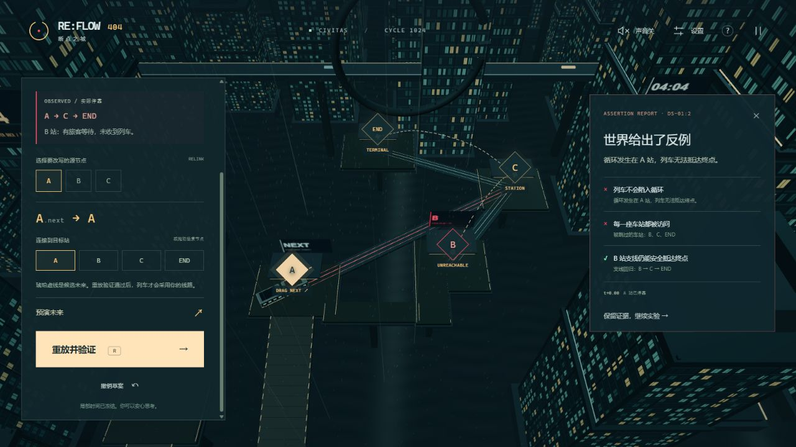

### 回到检查点在哪里

在普通移动状态按 **Esc**，或者点右上角暂停按钮，会看到下面的菜单。点 **「回到检查点」**可以重新站回安全位置。

如果正在工作台里，先按一次 Esc 关闭工作台，再按一次 Esc 打开这个菜单。

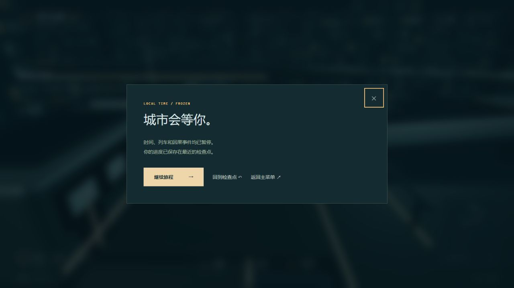

### 进度怎么保存

进度会自动保存在**当前浏览器**里，包括当前城市、晴雨、集电台状态、证据与两城已完成任务。下次进入首页点「**继续旅程**」，会回到对应安全检查点。旧 V6 首城存档会自动补充第二城字段，无需重玩第一城。

换浏览器、换设备、切换不同站点地址，或清除站点数据后，不会自动带上原来的存档。点击「**进入指针港**」或「**重新修复**」会开始新一局；想接着玩，请用「继续旅程」。

<a id="development"></a>

## 版本、源码与验收

当前为 **V6.1「指针港 + 脉冲炉」**：事件重排、链路修复、晴雨供电、进位接线、两城旅行、升降台和各城结算。其余六主城、ROOT 终章、战斗和完整跨城依赖系统属于后续开发。

当前 **62 项单元测试通过**。两城实走、错误方案、正确提交、天气保电、跨城续玩和手机关键操作的记录见[第二城验收报告](docs/v6/FORGE_QA.md)；[首城原验收报告](docs/v6/QA_REPORT.md)保留历史基线。本页截图来自实际游玩。

- [开发、构建与工程结构](docs/v6/DEVELOPMENT.md)
- [完整验收报告](docs/v6/QA_REPORT.md)
- [重设计说明](docs/v6/REDESIGN.md)
- [素材来源与许可](docs/ASSET_LICENSES.md)
- [零号角色概念与生成记录](docs/v6/CHARACTER_PROMPT.md)
- [部署说明](docs/v6/RELEASE.md)

<details>
<summary>开发者：命令速查</summary>

使用 Node.js 24 或更高版本。在仓库根目录运行：

```sh
npm ci
npm test
npm run build
npm run preview -- --host 127.0.0.1 --port 5387 --strictPort
```

`dist/` 是生产发布目录。本地开发使用 `npm run dev -- --host 127.0.0.1 --port 5386 --strictPort`。

原 V5 入口保留在 `legacy-v5.html`，旧版代码在 `src/main.ts`、`src/v5/`；现在的首页与正式构建使用 V6。

</details>
