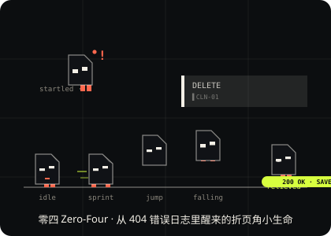

# 主角卡 · 零四（Zero-Four）

## ① 一句话设定

> **零四：一只由断开的网页折角和两只错位像素眼组成的小小 404 精灵——它出生的证明是一个错误码，它脚下的世界是你正在看的这张网页。**

五个识别锚点（32×32 仍可辨）：

1. 外轮廓不是圆球，是**一片折起的页面角**（方体 + 右上折角斜切）
2. 右上缺口像 `>`，**跑动时会张合**
3. 两眼错位且**不同步眨眼**（左低右高，程序不太稳定）
4. 双腿极短但跑得飞快，落点带惯性甩尾（squash & stretch）
5. 主体近黑 `#101216`，只有胸口的暖橙 `#FF684E` 小标记 + 同色小短腿

## ② 角色设定图

六姿态：idle / sprint / jump / falling / relieved / startled，以及它的天敌 CLN-01 清理波。

## ③ 游戏内实机

游戏中的零四由 Canvas 2D 逐帧程序化绘制（`src/effects/CharacterRenderer.ts`），与 DOM 网页世界叠加：

| 状态 | 实机表现 |
| --- | --- |
| 待机/跑动 | 短腿高频摆动、折角随步伐张合、错位双眼独立眨眼 |
| 自动跳跃 | 收腿、抛物线积分（引擎真实物理） |
| 落地 | 35% 纵向压缩 + 纸尘粒子 |
| 犹豫 | 站台边缘显示橙色 `!`（前方无路可跳） |
| 濒危 | 清理波 <240 单位时冒汗滴 |
| 得救 | 终局跳进 SAVE 出口，`404 → 200 OK` |

实机截图：`../artifacts/`（首屏菜单 / 200 OK 胜利画面）。

## ④ AI 制作说明（如实记录）

- 角色设计执行自规格书 §04.2 的 AI 提示词方案，最终以**程序化矢量/Canvas 绘制**落地（规格书允许且推荐的稳妥路径：AI 概念定稿 + 代码分件绘制，保证帧间一致性）。
- **本作未使用独立 AI 绘图工具生成位图素材**，全部视觉（角色、页面世界、UI）为代码原创绘制——特此如实说明，不以 SVG 冒充 AI 生成图。
- 开发过程由 AI 编程协作工具（Codex 类）按总纲执行：纯 TS 引擎、DOM 物理桥、30 项单测全部可复现。
